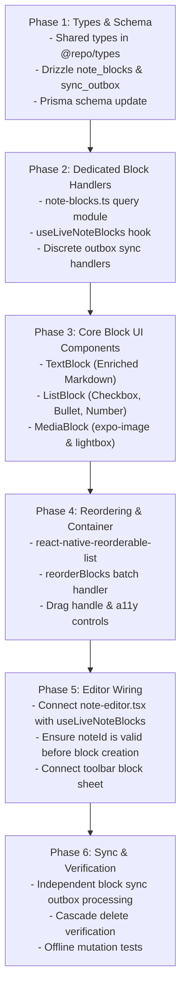

# Implementation Plan: Block-Based Note Editor Experience

This document details the architectural specification and rollout plan for integrating the block-based editor into the **iKeen** mobile application (`apps/mobile`), treating blocks as discrete entities with dedicated handlers, hooks, and sync outbox lifecycle.

---

## 1. Architectural Strategy & Guiding Principles

### 1.1 First-Class Block Separation & Relational Constraints
- **Independent Block Handlers**: Blocks are not treated as secondary embedded arrays of a note. They are first-class domain models managed via dedicated queries and mutation hooks (`apps/mobile/src/lib/queries/note-blocks.ts`).
- **Strict Foreign Key Invariant**:
  - `note_blocks.note_id` strictly references `notes.id` (`onDelete: cascade`).
  - No dummy/unattached blocks: The UI and hooks guarantee a valid `noteId` exists before any block can be instantiated or saved.
- **Dedicated Sync Outbox Lifecycle**:
  - `sync_outbox` supports `entity: 'note_blocks' | 'notes' | 'folders'`.
  - Block creations, edits, reordering, and deletions enqueue discrete, typed outbox mutations keyed by `blockId` with `noteId` payloads.
  - Deleting a note cascades deletion to its blocks locally and remotely without dangling sync jobs.

### 1.2 The Mutual Exclusivity & Prepend Conversion Rule
- **Mutual Exclusivity**: A note exists in either Legacy Mode (`note.content !== ""`, blocks empty) or Block Mode (`note.content === ""`, structured blocks active).
- **Idempotent Prepend Conversion**:
  - If a note with non-empty `note.content` is opened in the block editor, it is converted into a `TextBlock` at `position: 0`.
  - Once converted and saved, `note.content` is set to `""`, and subsequent updates strictly mutate `note_blocks`.
- **Card Preview & Search Optimization**:
  - `NoteCard` and search queries utilize `notes.summary` or extract an excerpt from the first `text` block to avoid parsing block tables during grid rendering.

---

## 2. Data Models & Schema Design

### 2.1 Shared TypeScript Interfaces (`packages/types/src/notes.ts`)

```typescript
export type BlockType = 'text' | 'list' | 'media';
export type ListType = 'checkbox' | 'bullet' | 'ordered';

export interface ListItem {
  id: string;
  content: string;
  checked?: boolean;
}

export interface MediaItem {
  id: string;
  mediaType: 'image' | 'audio' | 'file';
  localUri: string;
  url?: string;
  caption?: string;
  synced: boolean;
}

export interface BaseBlock {
  id: string;
  noteId: string;
  position: number;
  createdAt: string;
  updatedAt: string;
}

export interface TextBlock extends BaseBlock {
  type: 'text';
  content: string; // Markdown string
}

export interface ListBlock extends BaseBlock {
  type: 'list';
  listType: ListType;
  header?: string;
  footer?: string;
  content: ListItem[];
}

export interface MediaBlock extends BaseBlock {
  type: 'media';
  content: MediaItem[];
}

export type NoteBlock = TextBlock | ListBlock | MediaBlock;
```

### 2.2 Mobile SQLite / Drizzle Schema (`apps/mobile/src/db/schema.ts`)

```typescript
export const noteBlocks = sqliteTable(
  'note_blocks',
  {
    id: text('id').primaryKey(),
    noteId: text('note_id')
      .notNull()
      .references(() => notes.id, { onDelete: 'cascade' }),
    type: text('type', { enum: ['text', 'list', 'media'] }).notNull(),
    position: integer('position').notNull(),
    // Unified content payload: string for text, JSON string for list & media payloads
    content: text('content').notNull(),
    createdAt: text('created_at').notNull(),
    updatedAt: text('updated_at').notNull(),
  },
  (table) => [
    index('idx_note_blocks_note_id_position').on(table.noteId, table.position),
    index('idx_note_blocks_note_id').on(table.noteId),
  ]
);

// syncOutbox updated to include 'note_blocks'
export const syncOutbox = sqliteTable(
  'sync_outbox',
  {
    id: text('id').primaryKey(),
    entity: text('entity', { enum: ['folders', 'notes', 'note_blocks'] }).notNull(),
    entityId: text('entity_id').notNull(),
    action: text('action', { enum: ['upsert', 'delete'] }).notNull(),
    // ...
  }
);
```

### 2.3 Backend Prisma Schema (`apps/backend/prisma/schema.prisma`)

```prisma
model Note {
  id        String      @id @default(uuid())
  userId    String?
  folderId  String?
  title     String
  tags      String[]    @default([])
  content   String      @default("")
  blocks    NoteBlock[]
  createdAt DateTime    @default(now())
  updatedAt DateTime    @updatedAt

  @@index([updatedAt])
}

model NoteBlock {
  id        String    @id @default(uuid())
  noteId    String
  note      Note      @relation(fields: [noteId], references: [id], onDelete: Cascade)
  type      BlockType
  position  Int
  content   Json
  createdAt DateTime  @default(now())
  updatedAt DateTime  @updatedAt

  @@index([noteId, position])
  @@index([noteId])
}

enum BlockType {
  text
  list
  media
}
```

---

## 3. Dedicated Hooks & Handler Architecture


```
apps/mobile/src/
├── lib/queries/
│   ├── notes.ts                  # Note-level operations (title, tags, folders, pin/archive) - Discrete block operations, live queries, & outbox handlers
└── components/notes/blocks/
    ├── block-container.tsx       # Manages block list layout with reorderable list
    ├── block-wrapper.tsx         # Drag handle, options, move up/down/delete actions
    ├── text-block.tsx            # Markdown text block component
    ├── list-block.tsx            # Checkbox / bullet / ordered list block
    └── media-block.tsx           # Image & media attachment block
```

### 3.1 Block Operations in `lib/queries/notes.ts`
- `getNoteBlocks(noteId: string): Promise<NoteBlock[]>`
- `createBlock(noteId: string, input: CreateBlockInput): Promise<NoteBlock>` (enqueues `note_blocks` outbox upsert)
- `updateBlock(blockId: string, updates: Partial<NoteBlock>): Promise<void>` (enqueues `note_blocks` outbox upsert)
- `deleteBlock(blockId: string): Promise<void>` (enqueues `note_blocks` outbox delete)
- `reorderBlocks(noteId: string, blockIds: string[]): Promise<void>` (updates positions and enqueues sync)
- `convertNoteContentToBlock(note: Note): Promise<void>` (promotes `note.content` to `position: 0` text block in a transaction)

```
apps/mobile/src/components/notes/blocks/
├── block-container.tsx           # Coordinates array of blocks, reorder callbacks, active focus
├── block-wrapper.tsx             # Drag handle (GripVertical), accessible move up/down/delete actions
├── text-block.tsx                # EnrichedMarkdownTextInput (edit) & MarkdownBody (read)
├── list-block.tsx                # Checkbox / Bullet / Ordered list with optional header & footer
├── media-block.tsx               # Image/audio gallery preview with expo-image, lightbox & camera/gallery
└── block-reorder-list.tsx        # react-native-reorderable-list integration
```

### 3.1 Library Choice Rationale: `react-native-reorderable-list`
- **Why Not `react-native-reanimated-dnd`?**
  `react-native-reanimated-dnd` is a generic 2D drag-and-drop tool intended for canvas-style interfaces. It lacks native scroll container auto-scrolling, list virtualization, and 1D vertical slot snapping.
- **Why `react-native-reorderable-list`?**
  1. **Built specifically for 1D vertical list reordering**: Includes edge auto-scrolling (when dragging near screen edges) and auto-height animations out of the box.
  2. **100% Native Thread Worklets**: Uses `react-native-reanimated` v4 and `react-native-gesture-handler` (both already installed in `@repo/mobile`). Compatible with Expo SDK 57 and React Native 0.86 New Architecture (Fabric).
  3. **Dedicated Hook**: Provides `useReorderableDrag` for instant connection to the drag handle.

### 3.2 Block-Specific UI Requirements
1. **`TextBlock`**:
   - **Editing**: Uses `react-native-enriched-markdown` (`EnrichedMarkdownTextInput`). Supports markdown shortcuts (`# `, `- `, `**bold**`).
   - **Viewing**: Renders `MarkdownBody` with clickable links and syntax styling.
2. **`ListBlock` (`checkbox` | `bullet` | `ordered`)**:
   - **Header & Footer**: Renders clean, styled optional section labels (e.g. "Sprint Deliverables", footer: "Due Friday" or progress indicators).
   - **Interactive in View Mode**: Tapping checkboxes toggles `checked` state immediately with haptics.
   - **Inline Editing**:
     - Typing in an item edits its text.
     - Pressing **Enter** creates a new list item below.
     - Pressing **Backspace** on an empty item removes it.
     - 1-click conversion between list types (`checkbox` <-> `bullet` <-> `ordered`).
3. **`MediaBlock`**:
   - Renders image attachments using `expo-image` for high-performance memory caching and blurhashes.
   - Shows sync state badge (`synced: boolean`).
   - Fullscreen modal preview on tap.

---

## 4. Phased Implementation Roadmap



### Phase 1: Schema & Type Definitions
- Add `NoteBlock` interfaces in `packages/types/src/notes.ts`.
- Add `noteBlocks` table and expand `syncOutbox.entity` enum to include `'note_blocks'` in `apps/mobile/src/db/schema.ts`.
- Update Prisma schema in `apps/backend/prisma/schema.prisma`.

### Phase 2: Independent Block Handlers & Hooks
- Create `apps/mobile/src/lib/queries/note-blocks.ts` with dedicated CRUD operations and `enqueueOutbox` calls for `note_blocks`.
- Create `useLiveNoteBlocks(noteId)` and `useNoteBlockActions(noteId)`.
- Ensure new notes guarantee a persistent `noteId` before child block creation.

### Phase 3: Block Component Suite
- Implement `text-block.tsx`, `list-block.tsx`, `media-block.tsx`, and `block-wrapper.tsx` in `apps/mobile/src/components/notes/blocks/`.

### Phase 4: Drag & Drop Reordering
- Integrate `react-native-reorderable-list`.
- Wire `reorderBlocks` handler to update `position` indices.

### Phase 5: Editor Integration
- Update `note-editor.tsx` to consume `useLiveNoteBlocks(note.id)` directly.
- Wire `editor-toolbar-blocks.tsx` to invoke `addBlock(note.id, type)`.

### Phase 6: Sync & Verification
- Update sync manager worker to process `note_blocks` entities independently.
- Verify foreign key cascade deletions and offline persistence.
- Run typecheck and lint passes (`bun run check-types`).

---

## 5. Verification Checklist & Success Criteria

- [ ] **Strict Foreign Key Relational Integrity**: Every block belongs to a valid `noteId`; no dummy UI blocks can exist unparented.
- [ ] **Independent Sync Outbox**: Block additions, updates, and removals enqueue discrete `note_blocks` outbox records.
- [ ] **Isolated Hook Handlers**: `useLiveNoteBlocks` and `useNoteBlockActions` manage block state cleanly without polluting note-level state.
- [ ] **Deterministic Prepend Conversion**: Legacy notes convert cleanly to a `position: 0` block upon initial transition.
- [ ] **Smooth Reordering**: Reorder operations update position indices and trigger atomic position updates.
