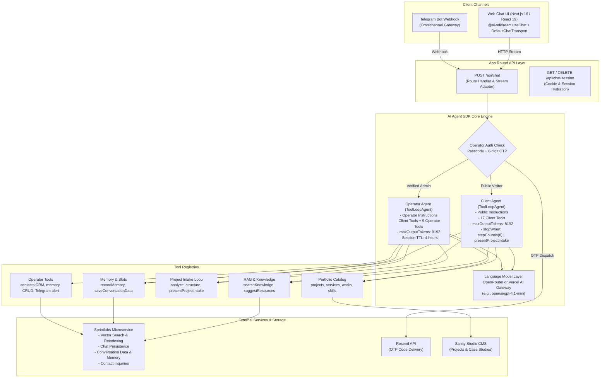
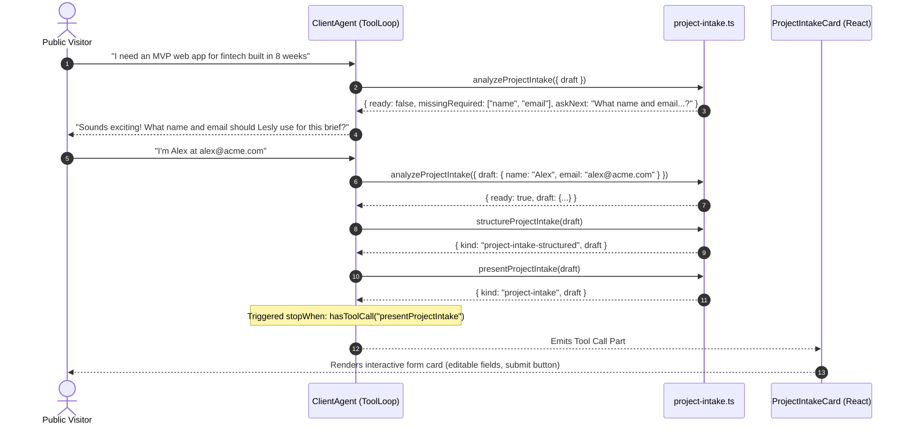
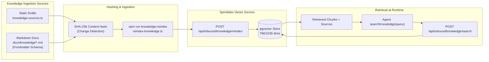

# AI Agent SDK Setup & Architecture Analysis

> **Project:** `devlee-portfolio`  
> **Assistant Persona:** **Lee** (Lesly Chuo's portfolio guide and operations agent)  
> **Core Framework:** Vercel AI SDK Core (`ai` `v7.0.33`), `@ai-sdk/react` (`v4.0.36`), Next.js 16 App Router (React 19), and Sprintlabs Inbound Integration.  
> **Generated:** March 2026

---

## 1. Executive Summary

The repository `devlee-portfolio` houses a modern, production-grade AI Agent infrastructure. Rather than relying on simple text completion or rigid pre-baked chatbots, the system implements an autonomous, multi-turn **`ToolLoopAgent`** architecture powered by the Vercel AI SDK (`ai` v7). 

The agent, named **Lee**, operates under a **dual-agent security architecture**:
1. **Client Agent (`lee-client-agent`)**: Serves public portfolio visitors with deep contextual knowledge, live portfolio metadata retrieval, project intake automation, and interactive generative UI cards.
2. **Operator Agent (`lee-operator-agent`)**: An authenticated administrative persona activated via a zero-trust **Passcode + Two-Factor Email OTP** verification loop. It grants privileged operations: editing memory notes, updating inbound contact CRM statuses, inspecting conversation data, and sending outbound Telegram notifications.

All persistent entities—including conversational message histories, episodic memory records, key-value session context, and pgvector RAG embeddings—are abstracted and synced with an inbound microservice platform codenamed **Sprintlabs**.

---

## 2. High-Level System Architecture



---

## 3. Core AI Agent SDK Setup & Design Patterns

### 3.1 Vercel AI SDK Core (`ai: ^7.0.33`)

The project uses the latest Vercel AI SDK abstractions centered on `ToolLoopAgent` and `createAgentUIStreamResponse`:
- **`ToolLoopAgent`**: Replaces manual multi-step `streamText` recursion loops. It manages autonomous tool calling cycles up to configurable limits.
- **Dynamic Context Injection (`prepareCall` & `toolsContext`)**:
  Both agents specify a `callOptionsSchema` requiring `{ conversationId: string; channel: "web" | "telegram" }`. On every request, `prepareCall` dynamically binds the active `conversationId` into the `toolsContext` and compiles channel-specific prompt variations.
- **Active Tool Pruning per Channel**:
  When communicating via Telegram, UI-bound tools (`presentProjectIntake` and `structureProjectIntake`) are automatically omitted from `activeTools`, preventing generative web cards from breaking text-only messaging channels.
- **Termination Guards (`stopWhen`)**:
  ```ts
  stopWhen: [stepCountIs(8), hasToolCall("presentProjectIntake")]
  ```
  Prevents infinite execution loops while ensuring that once an interactive project intake form is emitted to the user, the agent immediately yields the turn.

### 3.2 Provider & Model Layer (`lib/ai/provider.ts`, `lib/ai/model.ts`)

The SDK setup supports a dual-provider abstraction governed by `env.AI_PROVIDER`:
1. **OpenRouter Provider (`@openrouter/ai-sdk-provider`)**:
   - Uses `createOpenRouter({ apiKey: env.OPENROUTER_API_KEY })`.
   - Embeddings utilize `@ai-sdk/openai` configured with OpenRouter's OpenAI-compatible endpoint `https://openrouter.ai/api/v1`.
2. **Vercel AI Gateway (Default)**:
   - Uses model string identifiers directly (e.g. `openai/gpt-4.1-mini` for chat and `openai/text-embedding-3-small` for embeddings).
3. **Completion Budgets**:
   - Hardcoded `maxOutputTokens: 8192` to avoid provider-specific truncated defaults.
   - Request timeout set to `maxDuration = 60` seconds.

### 3.3 Operator Authentication & Zero-Trust State Machine (`lib/ai/operator-auth.ts`)

To allow Lesly Chuo to manage portfolio inquiries and memory on the go without maintaining a separate admin portal:
1. **Trigger**: User types `/operator <PASSCODE>` in chat.
2. **First Factor**: Verified against `env.ADMIN_PASSCODE`.
3. **Second Factor (2FA OTP)**: Generates a cryptographically random 6-digit OTP code, stores it with a 10-minute expiry and attempt counter (`<otp>:<attempts>`), and emails it via Resend to `env.EMAIL_REPLY_TO`.
4. **Validation**: The user enters the OTP in the chat thread. Upon success:
   - Sets `isOperator: true` with a 4-hour session TTL (`OPERATOR_SESSION_TTL_MS = 14,400,000`).
   - Dispatches a security alert to Telegram (`alertOperatorAuthenticated`).
5. **Deactivation**: Explicitly deactivated via `/logout` or after session expiry.

---

## 4. Detailed Tool Registry

Tools are strictly split into **Client Tools** (safe for public consumption) and **Operator Tools** (bound only by the authenticated operator agent).

### 4.1 Client Tools (`apps/client/lib/ai/tools/`)

| Tool Name | Module | Purpose | Schema / Context |
| :--- | :--- | :--- | :--- |
| `searchKnowledge` | `knowledge-base.ts` | RAG semantic vector search over Lesly's documents. | `query: string`, `limit?: number` |
| `suggestResources` | `knowledge-base.ts` | Suggests verified on-site routes from the allowlist. | `query: string` |
| `handoffToHuman` | `handoff.ts` | Escalates to human follow-up when queries cannot be answered. | `reason`, `visitorContact`, `summary` |
| `recordMemory` | `memory.ts` | Persists episodic memory about user preferences and project scope. | `category`, `description`, `importance` |
| `saveConversationData` | `conversation-data.ts` | Saves key-value structured data points into Sprintlabs. | `key`, `value`, `notes` |
| `listWorks` | `works.ts` | Lists featured works, client engagements, and roles. | Filter parameters |
| `getWorkDetails` | `works.ts` | Retrieves comprehensive case study details for a work item. | `slug: string` |
| `listProjects` | `projects.ts` | Retrieves live projects from Sanity Studio CMS. | Filter by featured/category |
| `getProjectDetails` | `projects.ts` | Full project metadata including stack, challenges, and links. | `slug: string` |
| `listServices` | `services.ts` | Lists available consulting and development services (LetechCG). | - |
| `getServiceDetails` | `services.ts` | In-depth breakdown of deliverables, pricing tiers, and timeline. | `serviceId: string` |
| `listExperiences` | `experiences.ts` | Employment history, instruction, and leadership roles. | - |
| `getExperienceDetails` | `experiences.ts` | Granular responsibilities and achievements per role. | `companyOrRole: string` |
| `getSkills` | `experiences.ts` | Skill matrix (languages, frameworks, cloud, data engineering). | Category filter |
| `analyzeProjectIntake` | `project-intake.ts` | Analyzes conversation to extract project brief facts; returns missing fields & next question. | `draft: candidateSchema` (uses context `conversationId`) |
| `structureProjectIntake`| `project-intake.ts` | Normalizes candidate facts into catalog services, timelines, and budgets. | `structureDraftSchema` |
| `presentProjectIntake` | `project-intake.ts` | Generates the interactive confirmation card for the web client. | `projectIntakePresentSchema` |

### 4.2 Conversational Project Intake Flow



### 4.3 Operator Tools (`apps/client/lib/ai/tools/operator/`)

| Tool Name | Module | Functionality |
| :--- | :--- | :--- |
| `logoutOperator` | `session.ts` | Deactivates operator status, reverting session to public visitor. |
| `listMemoryRecords` | `memory.ts` | Queries persisted memories across categories and importance ratings. |
| `createOperatorMemory` | `memory.ts` | Directly records high-priority administrative or client observations. |
| `deleteMemoryRecord` | `memory.ts` | Removes obsolete or sensitive memory records from Sprintlabs. |
| `listConversationDataRecords` | `memory.ts` | Inspects stored slot variables for any conversation thread. |
| `listContactMessages` | `contacts.ts` | Lists inbound inquiries and contact submissions with status filters. |
| `getContactDetails` | `contacts.ts` | Fetches full message payload, sender metadata, and timestamps. |
| `updateContactStatus` | `contacts.ts` | Updates submission status (`NEW`, `IN_REVIEW`, `REPLIED`, `ARCHIVED`). |
| `sendClientTelegramMessage` | `messaging.ts` | Dispatches outbound operational alerts directly to Lesly's Telegram chat. |

---

## 5. Prompt Engineering & Segment System (`lib/ai/prompts/`)

The prompt system is modularized into reusable segments rather than monolithic strings:

```
apps/client/lib/ai/prompts/
├── segments.ts      # Core reusable segments and channel adapters
├── client.ts        # Composes Public Client instructions
├── operator.ts      # Composes Authenticated Operator instructions
└── index.ts         # Central exports and backward-compatible builders
```

### 5.1 Key Prompt Segments

1. **`PROMPT_SEGMENT_IDENTITY`**: Defines Lee as Lesly's portfolio guide and representative.
2. **`PROMPT_SEGMENT_PERSONALITY_AND_TONE`**: Establishes the 3-mode personality blend:
   - **Direct**: Concise, well-structured, clear answers first.
   - **Humorous**: Light wit, coffee/dev jokes without being forced.
   - **Poetic**: Vivid craft and systems architecture metaphors when earned.
3. **`PROMPT_SEGMENT_LINK_AND_FORMATTING`**: Strict link hygiene:
   - Markdown links must use exact allowed routes (`/projects`, `/services`, `/contact`, `/start-a-project`, `/resume`).
   - Forbids inventing broken external links.
4. **`PROMPT_SEGMENT_TOOL_ROUTING`**: Directs query classification:
   - Historical background, philosophy, policies $\rightarrow$ `searchKnowledge` (RAG).
   - Live case studies $\rightarrow$ `listProjects` / `listWorks`.
   - Pricing & consulting packages $\rightarrow$ `listServices`.
   - Contact & project inquiries $\rightarrow$ `analyzeProjectIntake` pipeline.
5. **`PROMPT_SEGMENT_TOKEN_EFFICIENCY`**: Directives to avoid wasteful tool calls and unnecessary conversational bloat.
6. **`PROMPT_SEGMENT_BRAND_AND_BOUNDARIES`**: Outlines brand guardrails (focus on sustainable digital infrastructure, LetechCG consulting).
7. **`PROMPT_SEGMENT_OPERATOR_ROLE`**: Replaces public persona with concise, direct administrative assistant mode.

---

## 6. RAG Knowledge & Vector Search Pipeline



### 6.1 Ingestion Sources

1. **Static In-Code Sources (`lib/ai/knowledge-sources.ts`)**:
   - Seed documentation for biographical data, core competencies, philosophy, and baseline portfolio FAQs.
2. **File-Backed Markdown Sources (`lib/ai/knowledge-files.ts`)**:
   - Reads all markdown files in `docs/knowledge/` (e.g., `about-me.md`, `work-process-and-policy.md`).
   - Uses `gray-matter` and `zod` to validate frontmatter:
     ```ts
     {
       slug: string;
       title: string;
       category: string;
       sourceUrl?: string; // Must start with '/' or 'https://'
       updatedAt?: string | Date;
     }
     ```

### 6.2 Incremental Reindexing & Content Provenance

- Computes a deterministic `SHA-256` content hash (`computeContentHash`) for every resource.
- On reindexing, Sprintlabs compares hashes against existing resources:
  - **Unchanged**: Skipped entirely (saving embedding API costs).
  - **Modified**: Chunks recreated and re-embedded.
  - **Orphaned**: Stale slugs purged automatically.
- CLI tools provided:
  - `bun run knowledge:reindex` (incremental sync)
  - `bun run knowledge:reindex --force` (full wipe and rebuild)

---

## 7. Persistence & Session Architecture

1. **Ephemeral Anonymous Sessions**:
   - Cookie: `CHAT_SESSION_COOKIE` containing a unique `cuid2` ID.
   - Salted cryptographic SHA-256 hash (`hashSessionId`) is sent to the server.
   - Prevents unauthorized cross-session history snooping (`resolveOwnedConversationId`).
2. **Sprintlabs Persistence Layer**:
   - Stores conversations (`SupportConversation`), individual messages (`SupportMessage`), episodic memory (`MemoryRecord`), and arbitrary session key-values (`ConversationDataRecord`).
3. **Session Hydration Endpoint (`/api/chat/session`)**:
   - `GET`: Reads session cookie, retrieves messages and conversation ID from Sprintlabs.
   - `DELETE`: Clears session cookie and resets chat state.

---

## 8. Frontend & Generative UI Architecture

### 8.1 Component Hierarchy

```
apps/client/components/support-agent/
├── support-agent.tsx            # Floating launcher + Right Slide-over Sheet
├── support-chat.tsx             # Main chat view using @ai-sdk/react useChat
├── support-tool-parts.tsx       # Tool status chips & interactive card router
├── project-intake-card.tsx      # Generative interactive Project Intake Form
├── support-sources.tsx          # Collapsible RAG citations and references
└── changing-tagline.tsx         # Animated header / persona taglines
```

### 8.2 Client Features
- **Responsive Sheet Behavior**: Full slide-over panel on mobile (with backdrop); non-modal side-dock on desktop (`@base-ui/react/dialog`).
- **History & Gesture Integration**: Pushes state to window history (`window.history.pushState({ leeChat: true })`) so mobile hardware Back button closes the drawer seamlessly.
- **Auto-Scrolling**: Driven by `use-stick-to-bottom` with smooth requestAnimationFrame scrolling on incoming token chunks.
- **Rich Streaming Markdown**: Implemented via `@streamdown/code`, `@streamdown/math`, `@streamdown/mermaid`, and `shiki`.
- **Tool UI Feedback**: Tool executions render as micro status chips (`Searching archives…`, `Brief ready`) so they inform the user without cluttering the chat bubble.

---

## 9. Comprehensive File Structure Analysis

```
devlee-portfolio/
│
├── .agents/                               # Antigravity & Agentic Skills
│   └── skills/
│       └── sanity-best-practices/         # Sanity Studio CMS integration skills & references
│           ├── SKILL.md
│           └── references/                # Framework guidelines (Next.js, GROQ, Visual Editing)
│
├── .cursor/                               # Cursor IDE Rules & Settings
│   ├── rules/
│   │   └── developer-comments.mdc
│   └── settings.json
│
├── .models/                               # 3D Assets (Blender / Three.js GLB models)
│   ├── animated_robot_sdc.glb
│   ├── futuristic_flying_animated_robot_-_low_poly.glb
│   ├── iphone_15_pro_max.glb
│   └── iphone_illustration.glb
│
├── .ref/                                  # Resumes & reference PDFs
│   ├── Steve_Yonkeu_Resume_v2026_04.pdf
│   └── Copy of CV for Work (1).pdf
│
├── apps/
│   ├── studio/                            # Sanity Studio (CMS)
│   │   ├── package.json                   # "studio-lex-agent" dependencies
│   │   ├── sanity.config.ts               # Sanity studio configuration
│   │   ├── schemaTypes/                   # CMS Content Schemas
│   │   │   └── documents/project.ts       # Portfolio project schema
│   │   └── scripts/
│   │       └── import-projects.ts         # Data migration script for projects
│   │
│   └── client/                            # Next.js 16 Web Portfolio & AI Agent Host
│       ├── package.json                   # ai, @ai-sdk/react, @ai-sdk/openai, @openrouter/ai-sdk-provider
│       ├── next.config.ts
│       ├── tsconfig.json
│       │
│       ├── app/                           # Next.js App Router
│       │   ├── layout.tsx                 # Root layout injecting SupportAgentHost
│       │   ├── page.tsx                   # Portfolio homepage
│       │   │
│       │   └── api/                       # API Routes
│       │       ├── chat/
│       │       │   ├── route.ts           # Core POST endpoint (createAgentUIStreamResponse)
│       │       │   └── session/
│       │       │       └── route.ts       # GET/DELETE session hydration endpoint
│       │       ├── projects/react/route.ts
│       │       └── upload/route.ts
│       │
│       ├── components/
│       │   ├── ai-elements/               # Reusable AI primitives
│       │   │   ├── conversation.tsx       # Conversation container & scroll button
│       │   │   ├── message.tsx            # Bubble, content, and response renderer
│       │   │   └── suggestion.tsx         # Suggested query chips
│       │   │
│       │   └── support-agent/             # Agent Lee UI Package
│       │       ├── changing-tagline.tsx   # Dynamic persona status header
│       │       ├── project-intake-card.tsx# Interactive project intake form
│       │       ├── support-agent-host.tsx # Lazy-loaded agent host
│       │       ├── support-agent.tsx      # Sheet container & floating trigger button
│       │       ├── support-chat.tsx       # Core chat component (useChat hook)
│       │       ├── support-sources.tsx    # RAG citations list
│       │       └── support-tool-parts.tsx # Tool calling visual chips & card router
│       │
│       ├── docs/                          # Application-level knowledge sources
│       │   ├── applications/              # Cover letters and applications
│       │   └── knowledge/                 # Markdown RAG documents with YAML frontmatter
│       │       ├── about-me.md
│       │       └── work-process-and-policy.md
│       │
│       ├── lib/                           # Shared Libraries & Business Logic
│       │   ├── env.ts                     # Zod-validated environment schema
│       │   ├── resend.ts                  # Resend email dispatcher (OTP delivery)
│       │   ├── sprintlabs-intake.ts       # HTTP Client for Sprintlabs Microservices
│       │   │
│       │   ├── ai/                        # AI Agent SDK Subsystem
│       │   │   ├── agents/                # ToolLoopAgent Definitions
│       │   │   │   ├── call-options.ts    # Option schemas and dynamic context builders
│       │   │   │   ├── client-agent.ts    # Public Client Agent definition
│       │   │   │   ├── operator-agent.ts  # Authenticated Operator Agent definition
│       │   │   │   ├── lifecycle.ts       # Agent logging & step observers
│       │   │   │   └── index.ts           # Agent registry exports
│       │   │   │
│       │   │   ├── chat/                  # Chat Route Support Utilities
│       │   │   │   ├── auth-response.ts   # Synthetic assistant messages for auth
│       │   │   │   ├── messages.ts        # Message formatting & sanitization
│       │   │   │   ├── request.ts         # Request validation & parser
│       │   │   │   └── session.ts         # Session hashing & ownership enforcement
│       │   │   │
│       │   │   ├── prompts/               # Prompt Engineering Layer
│       │   │   │   ├── segments.ts        # Deconstructed modular prompt segments
│       │   │   │   ├── client.ts          # Public agent prompt compiler
│       │   │   │   ├── operator.ts        # Operator agent prompt compiler
│       │   │   │   └── index.ts           # Channel-aware prompt builder
│       │   │   │
│       │   │   ├── tools/                 # Tool Registries
│       │   │   │   ├── conversation-data.ts# Slot-filling conversation data tool
│       │   │   │   ├── experiences.ts     # Career experience & skill tools
│       │   │   │   ├── handoff.ts         # Human escalation tool
│       │   │   │   ├── knowledge-base.ts  # RAG search & resource suggestion tools
│       │   │   │   ├── memory.ts          # Episodic memory logging tool
│       │   │   │   ├── project-intake.ts  # 3-step intake pipeline (analyze/structure/present)
│       │   │   │   ├── projects.ts        # Sanity CMS project query tools
│       │   │   │   ├── services.ts        # Consulting catalog query tools
│       │   │   │   ├── tool-email.ts      # Shared email validation schema
│       │   │   │   ├── works.ts           # Featured works & case study tools
│       │   │   │   ├── index.ts           # Public tools registry export
│       │   │   │   └── operator/          # Elevated Operator Tools
│       │   │   │       ├── contacts.ts    # Inbound contact CRM query & status patch
│       │   │   │       ├── memory.ts      # Memory record CRUD tools
│       │   │   │       ├── messaging.ts   # Telegram notification tools
│       │   │   │       ├── session.ts     # Operator session logout tool
│       │   │   │       └── index.ts       # Operator tools registry export
│       │   │   │
│       │   │   ├── chat-persistence.ts    # Cookie definitions & session hashing
│       │   │   ├── embedding.ts           # Embedding model provider wrapper
│       │   │   ├── knowledge-files.ts     # Markdown parser & frontmatter validator
│       │   │   ├── knowledge-sources.ts   # Static knowledge seed drafts & hash helper
│       │   │   ├── knowledge.ts           # Reindex & retrieval orchestrator
│       │   │   ├── log.ts                 # Scoped structured logger
│       │   │   ├── model.ts               # Model factory wrappers
│       │   │   ├── operator-auth.ts       # Passcode + 2FA OTP state machine
│       │   │   ├── provider.ts            # Vercel Gateway & OpenRouter provider switches
│       │   │   ├── resources-allowlist.ts # Valid internal routes & URL allowlist
│       │   │   └── support-session-client.ts # TanStack Query hooks for session sync
│       │   │
│       │   └── telegram/                  # Telegram Gateway Integration
│       │       ├── alerts.ts              # Operator login & error telegram alerts
│       │       ├── client.ts              # Telegram Bot API client
│       │       └── markdown.ts            # Telegram MarkdownV2 formatter & escaping
│       │
│       ├── prisma/                        # Local Schema & Tooling
│       │   └── schema.prisma              # Local tooling stub (application models on Sprintlabs)
│       │
│       ├── scripts/                       # AI Agent & RAG Evaluation Scripts
│       │   ├── eval-support.ts            # Golden evaluation suite (allowlist, routing, retrieval)
│       │   ├── reindex-knowledge.ts       # CLI for incremental / forced RAG reindexing
│       │   ├── test-draft-embeddings.ts   # Embeddings generation smoke test
│       │   ├── test-file-knowledge.ts     # Markdown parsing validation
│       │   └── test-memory-logging.ts     # Memory persistence test runner
│       │
│       └── types/                         # TypeScript Definitions
│           └── schema.ts                  # Static interfaces mirroring Sprintlabs Prisma schema
│
├── data/
│   └── skill-map.json                     # Skill matrix data source
│
├── docs/                                  # Specifications & Architectural Roadmaps
│   ├── future-ai-agent.prompt.md          # Multi-modal, caching, and rate-limiting plans
│   ├── rag-knowledge-roadmap.md           # RAG enhancement milestones
│   ├── rag-system-analysis.md             # Chunk size & retrieval analysis
│   ├── storyboard.md                      # Product UX & 3D scene storyboards
│   ├── support-ai-agent.prompt.md         # Initial PRD & persona specification for Lee
│   └── support-ai-agent.setup.md          # Multi-phase engineering roadmap
│
└── screenshots/                           # Visual UI References
```

---

## 10. Evaluation & Testing Infrastructure

The repository provides a structured CLI testing suite in `apps/client/scripts/`:

1. **`knowledge:eval` (`scripts/eval-support.ts`)**:
   - Golden evaluation test checking query intent against:
     - Resource allowlist precision (`isAllowedHref`).
     - Handoff validation.
     - Optional live vector retrieval evaluation via `--gateway` and `--details`.
2. **`knowledge:reindex` (`scripts/reindex-knowledge.ts`)**:
   - Executes incremental diffing and vector embedding generation over static and file-backed documents.
3. **Embeddings & Memory Verification**:
   - `knowledge:test-embeddings` (`test-draft-embeddings.ts`): Smoke-tests provider embeddings against sample texts.
   - `test-memory-logging.ts`: Tests episodic memory persistence and retrieval.

---

## 11. Architectural Assessment & Recommendations

### Strengths
- **Decoupled Security**: Separation between `ClientAgent` and `OperatorAgent` guarantees that unauthenticated visitors cannot invoke CRM or administrative tools.
- **Autonomous Tool-Loop Control**: Utilizing `ToolLoopAgent` with explicit `stopWhen` and token budgets avoids endless reasoning loops while delivering smooth streaming.
- **Incremental Knowledge Sync**: Hashing docs before embedding prevents costly duplicate calls to LLM embedding endpoints.
- **Omnichannel Capability**: Built-in adaptation for Telegram alongside Web UI ensures that interactive cards don't break headless messengers.

### Evolution Opportunities (from `docs/future-ai-agent.prompt.md`)
1. **Semantic Caching**: Common static questions (e.g. bio, basic stack) can be cached in Redis / Upstash to cut latency and API token usage.
2. **Model Tiering**: Dynamically route simple greetings and intent checks to ultra-fast models (`gpt-4.1-nano` or Gemini Flash Lite) before escalating to larger models for complex briefs.
3. **Multi-Modal Interaction**: Support audio input/output (TTS via ElevenLabs / Whisper) and project diagram generation as envisioned in the agent roadmap.
