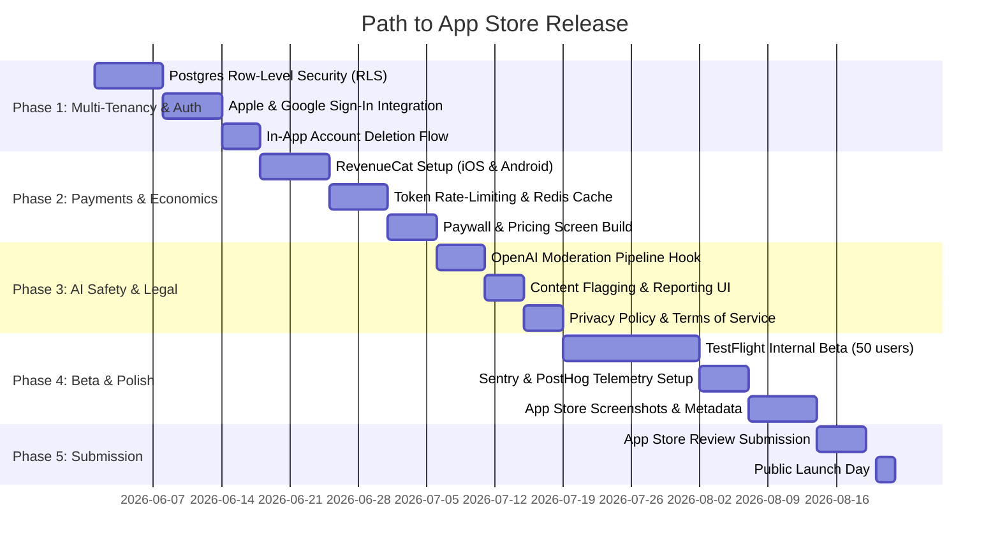

# Commercialization & App Store Release Criteria: Personal AI Life OS

> **Target Platform:** Apple App Store (iOS) & Google Play Store (Android)  
> **Prepared for:** Dev Lee (Lesly Chuo)  
> **Document Purpose:** Transitioning from a single-user personal operating system to a scalable, compliant, multi-tenant public commercial SaaS product.  
> **Date:** March 2026  

---

## 1. Executive Summary

Transitioning from a **personal tool** to a **public App Store product** requires shifting four fundamental architectural pillars:
1. **Data Architecture:** Moving from single-user assumptions to hard multi-tenant isolation via PostgreSQL Row-Level Security (RLS).
2. **Apple Compliance:** Satisfying Apple's strict AI Content Moderation, Account Deletion, and Privacy Nutrition Label mandates.
3. **Monetization Engine:** Integrating Apple In-App Purchases (IAP) via RevenueCat, calculating unit economics, and hedging against LLM token costs.
4. **Platform Experience:** Meeting Apple Human Interface Guidelines (native feel, 120 FPS animations, iPad responsiveness, and zero "web-view wrapper" artifacts).

```
┌─────────────────────────────────────────────────────────────────────────┐
│                    PUBLIC COMMERCIALIZATION ROADMAP                     │
│                                                                         │
│   [ 1. Multi-Tenancy ] ──▶ [ 2. Auth & IAP ] ──▶ [ 3. AI Compliance ]  │
│   • Postgres RLS           • Apple Sign-In       • OpenAI Moderation    │
│   • Tenant Key Vault       • RevenueCat Subscriptions • EULA & Report Flag  │
│   • Data Purge Engine      • Unit Economics      • Delete Account Flow  │
│                                                          │              │
│                                                          ▼              │
│                    [ 5. App Store Launch ] ◀── [ 4. TestFlight Beta ]   │
│                    • Apple & Google Approval   • 100 Power Users        │
│                    • Production Monitoring     • Sentry & PostHog       │
└─────────────────────────────────────────────────────────────────────────┘
```

---

## 2. Multi-Tenant Architecture & Data Isolation

To safely host thousands of external users without data leaks or cross-tenant contamination:

### 2.1 Database Row-Level Security (RLS)
Every table (`notes`, `note_chunks`, `personal_memories`, `reminders`, `conversations`) must be protected by PostgreSQL Row-Level Security:

```sql
-- Enable RLS on all tenant tables
ALTER TABLE notes ENABLE ROW LEVEL SECURITY;
ALTER TABLE note_chunks ENABLE ROW LEVEL SECURITY;
ALTER TABLE personal_memories ENABLE ROW LEVEL SECURITY;
ALTER TABLE reminders ENABLE ROW LEVEL SECURITY;
ALTER TABLE conversations ENABLE ROW LEVEL SECURITY;

-- Enforce strict tenant isolation policy
CREATE POLICY user_isolation_notes ON notes
  FOR ALL
  USING (user_id = current_setting('app.current_user_id')::uuid)
  WITH CHECK (user_id = current_setting('app.current_user_id')::uuid);

CREATE POLICY user_isolation_memories ON personal_memories
  FOR ALL
  USING (user_id = current_setting('app.current_user_id')::uuid)
  WITH CHECK (user_id = current_setting('app.current_user_id')::uuid);
```

### 2.2 Vector Search Multi-Tenancy
When running vector similarity queries (`pgvector`), the query **must always** filter by `user_id` before or during HNSW vector distance calculation to prevent cross-user knowledge leakage:

```sql
SELECT 
  nc.id, 
  nc.content, 
  1 - (nc.embedding <=> $1::vector) AS similarity
FROM note_chunks nc
JOIN notes n ON n.id = nc.note_id
WHERE n.user_id = $2::uuid  -- Mandatory tenant boundary
ORDER BY nc.embedding <=> $1::vector
LIMIT 5;
```

---

## 3. Authentication & Identity Management

### 3.1 Mandatory Apple Sign-In (Guideline 4.8)
Apple's App Store Review Guidelines strictly mandate:
> *If your app uses third-party or social login services (like Google, Facebook, or GitHub), you must also offer Sign in with Apple as an equivalent option.*

- **Implementation:** Use `expo-apple-authentication` for iOS native one-tap Sign in with Apple.
- **Support:** Offer Google Sign-In (`@react-native-google-signin/google-signin`) and Passwordless Magic Link Email as alternatives.
- **Anonymous-to-Authenticated Guest Flow:** Allow new visitors to immediately create a note locally on `expo-sqlite` as a guest, then silently migrate their local records to PostgreSQL once they authenticate.

---

## 4. Monetization & In-App Purchase (IAP) Architecture

### 4.1 Apple Guideline 3.1.1 Compliance (Payments)
- **Zero Stripe on iOS:** You **cannot** use Stripe, PayPal, or external web links inside your iOS app to unlock AI features or digital subscriptions. Doing so results in an immediate App Store rejection.
- **Apple Cut:** Apple takes a 15% commission (under the App Store Small Business Program) or 30% on all digital subscriptions.
- **The Solution:** Use **[RevenueCat](https://www.revenuecat.com/)** (`react-native-purchases`). It provides unified server-side receipt validation, subscription status sync, and paywalls across iOS and Android.

### 4.2 Pricing Tiers & Unit Economics

| Tier | Price | Model Access | Background Jobs & Ingestion | Target Economics |
| :--- | :--- | :--- | :--- | :--- |
| **Free / Starter** | **$0 / mo** | Gemini 2.5 Flash only | 50 notes max, manual reminders, no Telegram | Cost per user: <$0.08/mo (Loss leader) |
| **Pro Life OS** | **$14.99 / mo** (or $120/yr) | Claude 3.7 Sonnet + Gemini Flash | Unlimited notes, Inngest 11 PM consolidator, Telegram voice memo ingestion | Token cost: ~$2.80/mo (Margin: >75%) |
| **Power / Executive** | **$29.99 / mo** | Claude 3.7 + Flux 1.1 Pro + ElevenLabs | Daily morning audio briefing, deep research (Tavily), unlimited voice memos | Token cost: ~$7.50/mo (Margin: >70%) |
| **BYOK (Developer)** | **$4.99 / mo** | User brings own OpenRouter API key | Unlimited access to app infrastructure & Inngest jobs | Pure infrastructure profit |

### 4.3 Hedging Token Costs (Preventing Bill Shocks)
1. **Semantic Cache (Upstash Redis):** Cache identical semantic embeddings and common prompt evaluations to save up to 40% on API calls.
2. **Sliding Token Budgets:** Implement a monthly compute allowance (e.g. Pro users receive 2,000,000 reasoning tokens/month).
3. **Model Tiering:** Route routine note-categorization and entity extraction to Gemini 2.5 Flash ($0.075 / 1M tokens), reserving Claude 3.7 Sonnet ($3.00 / 1M tokens) strictly for multi-turn coaching and deep reasoning.

---

## 5. App Store Review Guidelines & AI Compliance

AI apps receive intense scrutiny from Apple review teams. Meeting the following criteria is mandatory for approval:

### 5.1 AI Content Safety & Moderation (Guideline 1.2)
Apple requires all apps featuring generative AI and user-generated content to implement safeguards:
1. **Automated Input/Output Guardrails:** Pass all inbound prompts and outbound agent responses through the **OpenAI Moderation API** (free) or **Llama Guard** to filter hate speech, self-harm, harassment, or illegal content.
2. **In-App "Report Content" Button:** Every AI chat bubble and generated note must include a subtle `[...]` menu with a `[Report Objectionable Content]` action.
3. **Clear Disclaimer:** The onboarding screen and chat footer must state:  
   *“AI can make mistakes. Verify important medical, legal, or financial information.”*
4. **Standard EULA Agreement:** Users must accept Apple's standard End User License Agreement (or your custom terms) during onboarding.

### 5.2 Mandatory In-App Account Deletion (Guideline 5.1.1(v))
Apple rejects any app that does not allow users to delete their account directly within the mobile UI:
- **Location:** Must be clearly accessible under `Settings` $\rightarrow$ `Account` $\rightarrow$ `Delete Account`.
- **Requirement:** Tapping "Delete Account" must immediately purge all notes, vector chunks, personal memories, and authentication records from the server (or schedule an irrevocable 30-day purge).

### 5.3 App Privacy Nutritional Labels (App Store Connect)
You must disclose all data collected:
- **User Content:** Audio recordings (voice memos), text notes (customer content).
- **Identifiers:** User ID, device ID (for push notifications).
- **Diagnostics:** Crash logs (via Sentry).
- **Usage Data:** Product interaction events (via PostHog).
- *Attestation:* You must declare that user data is **NOT** used for third-party tracking or sold to data brokers.

---

## 6. Technical Quality & Production Infrastructure

Apple review teams will reject apps that feel like simple "web wrappers" (Guideline 4.2 - Minimum Functionality):

### 6.1 Native Experience Requirements
- **Smooth 60/120 FPS Animations:** All transitions must run on the UI thread using `react-native-reanimated`.
- **Haptic Tactile Feedback:** Integrated with `expo-haptics` across switches, buttons, and swipe gestures.
- **Offline Reliability:** If airplane mode is enabled, the user must still be able to open the app, read cached notes, and write a new note with zero crashes or blocking alert dialogs.
- **iPad & Tablet Adaptive Layout:** The app must gracefully scale on iPad screens using a split-view master-detail layout rather than an stretched iPhone window.

### 6.2 Production Telemetry & Observability
- **Crash Reporting:** **Sentry for React Native** (`@sentry/react-native`) capturing native and JS thread crashes with breadcrumbs.
- **Product Analytics:** **PostHog** for feature adoption, retention cohorts, and paywall conversion funnels.
- **LLM Tracing & Cost Monitoring:** **Helicone** or **Langfuse** integrated with OpenRouter to monitor latency, cost per user, and error rates in real time.

---

## 7. Step-by-Step App Store Launch Checklist



### Phase 1: Multi-Tenancy & Auth
- [ ] Enforce PostgreSQL Row-Level Security policies on all tables.
- [ ] Implement Apple Sign-In (`expo-apple-authentication`) and Google Sign-In.
- [ ] Build in-app "Delete Account & Purge Data" flow under Settings.

### Phase 2: Monetization (RevenueCat)
- [ ] Configure RevenueCat project and set up Apple App Store Connect in-app subscriptions.
- [ ] Build dynamic paywall UI using NativeWind/Tailwind.
- [ ] Implement Upstash Redis token rate-limiting to protect margins.

### Phase 3: AI Safety & Legal
- [ ] Hook incoming/outgoing agent messages into OpenAI Moderation API.
- [ ] Add `[Report Content]` button to all AI message bubbles and generated notes.
- [ ] Host publicly accessible **Privacy Policy** and **Terms of Service** web pages.

### Phase 4: Beta Testing & Native Polish
- [ ] Run automated builds via **EAS Build** (`eas build --platform ios`).
- [ ] Distribute via **Apple TestFlight** to 50–100 beta testers.
- [ ] Fix edge-case crashes captured by Sentry.

### Phase 5: Submission & Launch
- [ ] Design App Store icon (1024x1024) and 6.7" / 6.5" iPhone display screenshots.
- [ ] Complete App Privacy Nutritional Labels in App Store Connect.
- [ ] Submit for App Store review with demo credentials for Apple reviewers.
- [ ] Official public launch!
