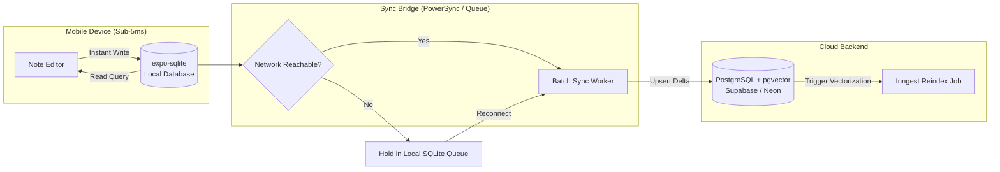

Here is the complete architectural analysis of what is needed across every layer of the mobile stack, fully aligned with the **Expo SDK 57+** runtime and the **React Native New Architecture** (Fabric, TurboModules, React 19 Concurrent):

---

```
┌─────────────────────────────────────────────────────────────────────────┐
│                    EXPO SDK 57+ MOBILE SUBSYSTEMS                       │
├───────────────────┬───────────────────┬─────────────────────────────────┤
│ ICONS & GRAPHICS  │ STYLING & TOKENS  │ STATE & DATA                    │
│ SF Symbols +      │ NativeWind v5 +   │ Zustand (Client/Aura)           │
│ Lucide + Skia     │ Glass Effect      │ TanStack Query v5 (Server)      │
├───────────────────┼───────────────────┼─────────────────────────────────┤
│ OFFLINE SYNC      │ BACKGROUND & PUSH │ AUTH & BIOMETRICS               │
│ expo-sqlite +     │ expo-task-manager │ LocalAuthentication (Face ID)   │
│ PowerSync (to PG) │ expo-notifications│ SecureStore (Keychain Tokens)   │
├───────────────────┼───────────────────┼─────────────────────────────────┤
│ HARDWARE & AUDIO  │ MOTION & GESTURES │ OBSERVABILITY                   │
│ expo-audio (New)  │ Reanimated 3/4 +  │ Sentry (Crash reporting)        │
│ Decibel metering  │ Gesture Handler   │ PostHog (Session telemetry)     │
└───────────────────┴───────────────────┴─────────────────────────────────┘
```

---

### 0. Expo UI: Expo’s Rapid-Development UI Component Library

Expo now provides a first-party, opinionated UI component library—**`expo-ui`**—which includes deeply optimized, accessible, themeable (dark/light/theming tokens) building blocks for rapid prototyping and production-quality design systems.

- **Key Features:**
  - Ready-made, accessible primitives: Button, Card, Checkbox, Input, Switch, Sheet, Modal, Toast, List, Spinner, Avatar, SegmentedControl, Progress, etc.
  - First-class TypeScript types and IntelliSense.
  - Theming engine compatible with NativeWind/Tailwind and React Native’s `Appearance`.
  - Peer dependency on Expo’s native modules for ripple effects, blur views, etc.
  - Runs anywhere Expo runs—iOS, Android, Web.
- **Example Usage:**

  ```tsx
  import { Button, Card, ThemeProvider } from "expo-ui";

  <ThemeProvider>
    <Card>
      <Card.Title>Welcome!</Card.Title>
      <Button
        onPress={() => alert("Clicked!")}
        color="primary"
        size="lg"
        icon="sparkles">
        Get Started
      </Button>
    </Card>
  </ThemeProvider>;
  ```

- **Why use expo-ui?**
  - “Expo UI” is maintained by the Expo team, closely follows the Expo SDK upgrades, and is heavily tested for performance with concurrent rendering, gestures, and dark mode.
  - If you need rapid, production-grade interfaces that align with mobile conventions (swipes, a11y, press/ripple, low-latency feedback)—start with `expo-ui` before building custom atomic/nano components.

---

### 1. Icons Library: The Dual-Engine Strategy

- **iOS Native (`expo-image` + SF Symbols)**:
  - In Expo 57, load SF Symbols directly via `expo-image`:
    ```tsx
    import { Image } from "expo-image";
    <Image
      source="sf:sparkles"
      style={{ width: 22, height: 22, tintColor: auraColor }}
    />;
    ```
  - _Why:_ Supports Apple's native variable weights, hierarchical palette colors, and system animations (`bounce`, `pulse`, `scale`).
- **Android & Universal Fallback (`lucide-react-native`)**:
  - For Android and shared web components, use **`lucide-react-native`**. Matches your web UI exactly, perfectly sits on a 24px grid, and supports dynamic stroke widths and SVG colors.

---

### 2. Assets & Rendering: Vector, Images, 3D, and Audio

- **Images**: **`expo-image`**
  - Essential for progressive WebP loading, memory/disk LRU caching, and native BlurHash placeholder rendering while images generate from Flux.
- **Audio Engine**: **`expo-audio`** _(Replaces deprecated `expo-av`)_
  - Low-latency microphone streaming, real-time decibel metering (to drive the pulsating voice orb), and background audio playback for morning briefs.
- **Reactive Shaders & Fluid Graphics**: **`@shopify/react-native-skia`**
  - Renders the real-time fluid visualizer orb (Experience 5), custom sparkline micro-charts (Experience 4), and dynamic gradient glass cards.
- **Vectors**: **`react-native-svg`** with `react-native-svg-transformer` for custom brand marks and icons.

---

### 3. Styling System: NativeWind v5 + Dynamic Aura Tokens

- **Utility Engine**: **NativeWind v5 (Tailwind v4)**:
  - Zero-runtime CSS compilation on the New Architecture with `react-native-css-interop`.
- **Dynamic Theme Bridging (`theme.ts`)**:
  - Pure Tailwind cannot dynamically animate persona colors. Bridge NativeWind with a typed theme object for Reanimated:
    ```ts
    export const PERSONA_AURAS = {
      work: { hex: "#00F2FE", glow: "rgba(0, 242, 254, 0.25)" },
      finance: { hex: "#10B981", glow: "rgba(16, 185, 129, 0.25)" },
      fitness: { hex: "#F97316", glow: "rgba(249, 115, 22, 0.25)" },
      coach: { hex: "#8B5CF6", glow: "rgba(139, 92, 246, 0.25)" },
      creative: { hex: "#EC4899", glow: "rgba(236, 72, 153, 0.25)" },
    } as const;
    ```
- **Liquid Glass (`expo-glass-effect`)**:
  - Native iOS liquid glass materials on tab bars, modal sheets, and floating capsules (`intensity: 45`, `tint: 'dark'`).
- **Corner Geometry**:
  - Strict enforcement of `{ borderCurve: 'continuous' }` across all containers.

---

### 4. State Management: The Split-Tier Pattern

Never store server data and client UI state in the same bucket:

1. **Client & Ephemeral State**: **Zustand**
   - Manages: Active persona (`work` vs `finance`), floating voice recorder state, active audio scrubber, and command palette open/close status.
   - Super light, works outside React lifecycle, zero boilerplate.
2. **Server & Cache State**: **TanStack Query v5 (`@tanstack/react-query`)**
   - Manages: Fetched notes, memory records, habit completions, and server-side task lists.
   - Built-in offline query caching and automatic refetch on network reconnect.

---

### 5. API & Streaming Layer: Vercel AI SDK on Mobile

- **Chat & Tool Streaming**: **`@ai-sdk/react` (`useChat` with native `fetch`)**
  - React Native 0.77+ New Architecture includes native `ReadableStream` support.
  - Streams LLM reasoning tokens and typed tool call events into the mobile chat view with zero stutter.
- **RPC & Mutation Layer**:
  - A lightweight `fetch` wrapper sharing TypeScript types directly from `packages/agent-core` via Turborepo.

---

### 6. Notifications: Local, Push & Actionable Lock-Screen Categories

- **Engine**: **`expo-notifications`**
- **Push Token Lifecycle**:
  - On app launch, get `ExpoPushToken` $\rightarrow$ register with backend user record.
- **Interactive Lock-Screen Categories**:
  - Users must be able to act without unlocking the phone:
    ```ts
    // Category: REMINDER_ACTIONS
    [Mark Done] -> Calls background headless task -> updates SQLite & PG
    [Snooze 15m] -> Re-arms local notification for +15 minutes
    ```
- **Local Notifications as Offline Fallbacks**:
  - When internet is down, the app schedules notifications directly into the iOS/Android system clock via `scheduleNotificationAsync`.

---

### 7. Background Tasks & Worker Routines

- **Engine**: **`expo-task-manager`** + **`expo-background-task`**
- **Key Tasks Registered**:
  1. `BACKGROUND_SYNC_TASK`: Wakes periodically (every 15–30 mins) to push dirty offline notes to the PostgreSQL backend.
  2. `BACKGROUND_AUDIO_TASK`: Keeps audio recording and playback active when the phone screen turns off (`UIBackgroundModes: ['audio', 'fetch']`).
  3. `ACTION_HANDLER_TASK`: Handles lock-screen notification button taps while the app is killed.

---

### 8. Animations & Physics: 120 FPS Worklets

- **Animation Engine**: **`react-native-reanimated` (v3/v4)**
  - All gesture updates and card springs run strictly on the native UI worklet thread.
- **Gesture Engine**: **`react-native-gesture-handler`**
  - Pinch-to-summarize, fling-to-agent, and swipe-to-archive.
- **Navigation Transitions**:
  - **`Link.AppleZoom`** in Expo Router for fluid expanding card transitions.
- **Micro-Haptics**:
  - **`expo-haptics`** triggered on worklet completions (light tick on swipe, success pop on task completion).

---

### 9. Auth & Biometric Hardware Security

- **Biometric Lock Gate**: **`expo-local-authentication`**
  - App checks `hasHardwareAsync()` $\rightarrow$ requires Face ID / Biometrics whenever the app resumes from the background.
- **Secure Token Vault**: **`expo-secure-store`**
  - Stores asymmetric JWT refresh tokens encrypted in the iOS Keychain and Android Keystore.
- **Apple Compliance**: **`expo-apple-authentication`**
  - One-tap native Sign in with Apple button.

---

### 10. Local-First & Offline Postgres Sync: The Second Brain Engine

For a personal daily app, network latency or spotty subway connectivity cannot block you from taking a note.



#### The Recommended Implementation: **PowerSync with `expo-sqlite`**

- **Why PowerSync:** It provides real-time, bi-directional sync between local `expo-sqlite` on the phone and your cloud PostgreSQL database.
- **How It Operates:**
  1. When you type or check a habit, the write happens locally in **`<5ms`** on SQLite.
  2. PowerSync automatically tracks the dirty row in a local write checkpoint.
  3. As soon as connectivity is restored, the changes are streamed upstream to Postgres via logical replication.
  4. Server-side changes (e.g. Inngest finished your 11 PM note consolidation) are silently pulled and merged into local SQLite.

---

### 11. Additional Must-Have Categories for Expo 57+

1. **Keyboard UX**: **`react-native-keyboard-controller`**
   - Far superior to native `KeyboardAvoidingView`. Enables interactive keyboard dismissal, sticky markdown accessory bars, and smooth 120 FPS height tracking without jumpy layout shifts.
2. **Live Activities & Dynamic Island**: **`@bacons/apple-targets`**
   - Config plugin that builds native Swift Widget targets for Expo. Displays audio recording waves or research progress bars in the iPhone Dynamic Island.
3. **Observability**: **`@sentry/react-native`** + **`posthog-react-native`**
   - Sentry catches native iOS/Android crashes with source maps; PostHog tracks offline feature usage and sync latency.
