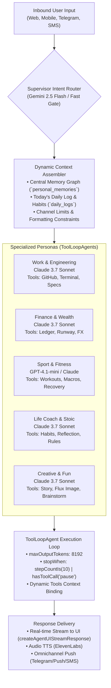
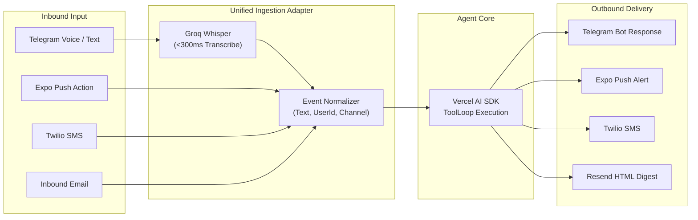
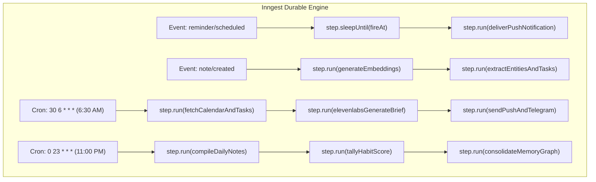

# Personal Agent System Specification (Production-Scale Architecture)

> **Document Version:** 1.0.0 (Production Blueprint)  
> **Target:** Dev Lee Personal Life OS & Agent Ecosystem  
> **Core Frameworks:** Vercel AI SDK Core (`ai` v7), Next.js 16 (App Router), Inngest (Durable Orchestrator), PostgreSQL + `pgvector`, Expo SDK 57+  
> **Security Baseline:** Zero-Trust, Biometric Mobile Auth, Row-Level Isolation, Vault Secrets  
> **Date:** March 2026  

---

## 1. Monorepo Repository Structure (Turborepo)

The repository is organized as a high-performance Turborepo monorepo sharing TypeScript configurations, Prisma models, agent personas, and UI primitives between the Next.js server and the Expo mobile application.

```
personal-os/
├── .github/
│   └── workflows/
│       ├── ci.yml                     # Typecheck, lint, unit tests
│       └── deploy.yml                 # Vercel (web) & EAS (mobile) CD
├── apps/
│   ├── mobile/                        # Expo SDK 57+ React Native App
│   │   ├── app/                       # Expo Router file-based routes
│   │   ├── components/                # Native UI components (NativeWind/Tailwind)
│   │   ├── hooks/                     # Custom React Native hooks
│   │   ├── lib/                       # Mobile storage (SecureStore, SQLite/PowerSync)
│   │   ├── app.json                   # Expo config, plugins, targets
│   │   ├── package.json
│   │   └── tsconfig.json
│   │
│   └── web/                           # Next.js 16 App Router (Backend + Desktop UI)
│       ├── app/
│       │   ├── (dashboard)/           # Desktop dual-pane notes & command center
│       │   ├── api/
│       │   │   ├── chat/route.ts      # Vercel AI SDK ToolLoopAgent streaming route
│       │   │   ├── inngest/route.ts   # Inngest background job webhook handler
│       │   │   ├── webhooks/
│       │   │   │   ├── telegram/      # Telegram Bot webhook (audio & text)
│       │   │   │   ├── twilio/        # SMS webhook handler
│       │   │   │   └── email/         # Resend inbound email parsing webhook
│       │   │   └── auth/              # Mobile token issuance & session routes
│       │   └── layout.tsx
│       ├── package.json
│       └── tsconfig.json
│
├── packages/
│   ├── agent-core/                    # Central Agent Orchestration Engine
│   │   ├── agents/                    # ToolLoopAgent instances & supervisor
│   │   ├── personas/                  # System prompts & persona segment builders
│   │   ├── skills/                    # Modular agent skills & playbooks
│   │   ├── tools/                     # Zod-validated tool definitions
│   │   ├── memory/                    # Episodic memory graph & context loaders
│   │   ├── rag/                       # Chunking, embeddings & vector search
│   │   └── index.ts
│   │
│   ├── database/                      # Shared Persistence Layer
│   │   ├── prisma/
│   │   │   ├── schema.prisma          # PostgreSQL + pgvector schema
│   │   │   └── migrations/
│   │   ├── src/                       # Prisma client wrapper & typed queries
│   │   └── package.json
│   │
│   ├── inngest-client/                # Durable Background Execution Layer
│   │   ├── src/
│   │   │   ├── client.ts              # Inngest instance definition
│   │   │   ├── functions/
│   │   │   │   ├── reminders.ts       # step.sleepUntil reminder dispatchers
│   │   │   │   ├── consolidator.ts    # Nightly 11 PM note & habit processing
│   │   │   │   ├── deep-research.ts   # Multi-step web crawler & report engine
│   │   │   │   └── morning-brief.ts   # 6:30 AM audio/text briefing job
│   │   │   └── events.ts              # Strongly-typed event schema
│   │   └── package.json
│   │
│   ├── channels/                      # Omnichannel Adapters
│   │   ├── src/
│   │   │   ├── telegram.ts            # Bot API, audio downloader, MarkdownV2
│   │   │   ├── push.ts                # Expo Server SDK push notifications
│   │   │   ├── sms.ts                 # Twilio REST client
│   │   │   └── email.ts               # Resend client + React Email templates
│   │   └── package.json
│   │
│   └── tsconfig/                      # Shared TS Configs (base, nextjs, react-native)
│
├── package.json                       # Monorepo root scripts (pnpm / bun workspaces)
├── turbo.json                         # Build caching, pipelines, task dependencies
└── .env.example                       # Documented environment variables
```

---

## 2. Agent Orchestration Engine

The orchestration layer is powered by **Vercel AI SDK Core (`ai` v7)**. It implements an autonomous, multi-turn **`ToolLoopAgent`** pattern coordinated by an intelligent intent supervisor.



### 2.1 The Dynamic Persona Switcher (`packages/agent-core/agents/router.ts`)

Instead of locking the user into a rigid dropdown menu, the **Supervisor Router** automatically classifies intent while allowing explicit user overrides:

```ts
import { generateObject } from "ai";
import { z } from "zod";
import { getFastModel } from "../models";

export const personaSchema = z.enum([
  "work",
  "finance",
  "fitness",
  "coach",
  "creative",
  "general",
]);

export type PersonaType = z.infer<typeof personaSchema>;

export async function routeUserIntent(text: string): Promise<PersonaType> {
  const result = await generateObject({
    model: getFastModel(), // Gemini 2.5 Flash for sub-200ms routing
    schema: z.object({
      persona: personaSchema,
      confidence: z.number().min(0).max(1),
    }),
    prompt: `Analyze the user's message and select the single best persona lens:
    - work: software development, architecture, projects, tasks, bugs.
    - finance: money, expenses, budget, savings, crypto, investments.
    - fitness: workout, gym, runs, nutrition, calories, sleep, recovery.
    - coach: life decisions, habit formation, emotional clarity, stoicism.
    - creative: storytelling, humor, entertainment, casual banter.
    - general: simple queries, generic Q&A, greetings.

    Message: "${text}"`,
  });

  return result.object.confidence > 0.65 ? result.object.persona : "general";
}
```

### 2.2 ToolLoopAgent Implementation (`packages/agent-core/agents/tool-loop.ts`)

Each persona runs as an isolated `ToolLoopAgent` instance configured with its specific prompt segments, completion budgets, and toolsets:

```ts
import { ToolLoopAgent, stepCountIs } from "ai";
import { getPrimaryModel } from "../models";
import { buildPersonaInstructions } from "../personas";
import { allTools } from "../tools";
import type { AgentCallContext } from "../types";

export function createPersonaAgent(persona: PersonaType, channel: "mobile" | "web" | "telegram") {
  return new ToolLoopAgent({
    id: `agent-${persona}`,
    model: getPrimaryModel(), // Claude 3.7 Sonnet
    instructions: buildPersonaInstructions(persona, channel),
    tools: allTools,
    maxOutputTokens: 8192,
    stopWhen: [
      stepCountIs(10), // Guard against infinite reasoning loops
    ],
    prepareCall: async ({ options, ...settings }) => {
      const ctx = options as AgentCallContext;
      return {
        ...settings,
        toolsContext: {
          userId: ctx.userId,
          conversationId: ctx.conversationId,
          channel: ctx.channel,
        },
      };
    },
  });
}
```

---

## 3. Tooling Architecture

Every tool is strictly defined with **Zod schemas**, typed execution handlers, and contextual awareness (knowing the requesting user, session ID, and delivery channel).

```
packages/agent-core/tools/
├── index.ts                   # Central tool registry export
├── context.ts                 # ContextSchema definition (userId, channel)
├── notes.ts                   # Note creation, search, edit, backlink
├── memory.ts                  # Episodic memory CRUD (personal_memories)
├── reminders.ts               # Inngest reminder event dispatcher
├── research.ts                # Tavily AI deep search & Firecrawl reader
├── image-gen.ts               # Flux 1.1 Pro image synthesis
├── finance.ts                 # Expense recording & budget analysis
└── fitness.ts                 # Workout logging & calorie calculation
```

### 3.1 Tool Schema Examples

#### Note Creation & Auto-Tagging Tool (`tools/notes.ts`)
```ts
import { tool } from "ai";
import { z } from "zod";
import { prisma } from "@personal-os/database";
import { inngest } from "@personal-os/inngest-client";

export const createNote = tool({
  description: "Create a new note or journal entry in the user's Second Brain.",
  contextSchema: z.object({ userId: z.string().min(1) }),
  inputSchema: z.object({
    title: z.string().default("Untitled"),
    content: z.string().describe("Markdown content of the note"),
    folder: z.enum(["inbox", "work", "finance", "fitness", "journal"]).default("inbox"),
    tags: z.array(z.string()).default([]),
  }),
  execute: async ({ title, content, folder, tags }, { context }) => {
    const note = await prisma.note.create({
      data: {
        userId: context.userId,
        title,
        content,
        folder,
        tags,
      },
    });

    // Trigger background vectorization & entity extraction
    await inngest.send({
      name: "note/created",
      data: { noteId: note.id, userId: context.userId },
    });

    return { id: note.id, status: "created", title: note.title };
  },
});
```

#### Natural Language Reminder Scheduler (`tools/reminders.ts`)
```ts
import { tool } from "ai";
import { z } from "zod";
import { inngest } from "@personal-os/inngest-client";
import { prisma } from "@personal-os/database";

export const scheduleReminder = tool({
  description: "Schedule a future reminder, task alert, or recurring habit ping.",
  contextSchema: z.object({ userId: z.string().min(1) }),
  inputSchema: z.object({
    title: z.string().describe("The actionable reminder text"),
    fireAtIso: z.string().describe("ISO 8601 target timestamp"),
    channel: z.enum(["push", "telegram", "sms"]).default("push"),
    priority: z.enum(["low", "normal", "urgent"]).default("normal"),
  }),
  execute: async ({ title, fireAtIso, channel, priority }, { context }) => {
    const reminder = await prisma.reminder.create({
      data: {
        userId: context.userId,
        title,
        fireAt: new Date(fireAtIso),
        channel,
        status: "PENDING",
      },
    });

    await inngest.send({
      name: "reminder/scheduled",
      data: {
        reminderId: reminder.id,
        userId: context.userId,
        title,
        fireAt: fireAtIso,
        channel,
        priority,
      },
    });

    return { status: "scheduled", reminderId: reminder.id, fireAt: fireAtIso };
  },
});
```

---

## 4. Skills Architecture (Playbooks & Extended Capabilities)

Skills represent high-level procedural workflows and domain playbooks stored as markdown instructions and scripts that agents consult dynamically.

```
packages/agent-core/skills/
├── finance-runway-audit/
│   ├── SKILL.md               # Playbook on calculating cash burn and tax reserves
│   └── calculator.ts          # Deterministic compounding and runway formulas
├── deep-research-synthesizer/
│   ├── SKILL.md               # Multi-source source verification and bias weighting
│   └── report-template.md     # Standardized executive research memo template
├── workout-progressive-overload/
│   ├── SKILL.md               # RPE guidelines, volume formulas, deload rules
│   └── calculations.ts        # 1RM estimates and volume tonnage calculator
└── weekly-life-review/
    ├── SKILL.md               # Sunday retrospective prompt structure
    └── schema.json            # Structured output schema for the weekly review
```

### How Skills Are Loaded
When an agent handles a complex task (e.g., "Run a financial audit on my monthly burn"), the agent checks its internal skill registry. If matched, the skill's `SKILL.md` instructions and validation logic are injected into the agent's context window on demand.

---

## 5. Omnichannel Gateways

The system is engineered so the user can interact via their preferred communication medium at any given moment.



### 5.1 Telegram Gateway (`packages/channels/src/telegram.ts`)
- **Voice Ingestion**: Accepts voice audio files (`.ogg`), downloads via Telegram Bot API, and pipes directly to **Groq Whisper Large v3**, achieving full transcription in under 300ms.
- **MarkdownV2 Escaping**: Implements strict escaping for Telegram characters (`_`, `*`, `[`, `]`, `(`, `)`, `~`, `` ` ``, `>`, `#`, `+`, `-`, `=`, `|`, `{`, `}`, `.`, `!`).
- **Inline Action Keyboards**: Interactive Telegram buttons (`[Confirm Note]`, `[Snooze 1h]`, `[Mark Habit Done]`).

### 5.2 Expo Push Notifications (`packages/channels/src/push.ts`)
- Uses official Expo Server SDK (`expo-server-sdk-node`).
- Registers **Interactive Notification Categories**:
  - Category `REMINDER`: Actions: `[DONE_ACTION]`, `[SNOOZE_15M_ACTION]`.
  - Category `HABIT_CHECK`: Actions: `[YES_COMPLETED]`, `[SKIP_TODAY]`.

---

## 6. Authentication & Security Architecture

The personal nature of this app requires military-grade data protection:

### 6.1 Authentication Topology
1. **Mobile Authentication**:
   - **LocalAuthentication**: Device biometrics (Face ID / Touch ID / Android BiometricPrompt) required on opening the app.
   - **SecureStore**: Stores an ephemeral, asymmetric JWT refresh token. Raw credentials and API keys are never stored on device.
2. **Server & Web Authentication**:
   - Next.js uses secure, `HttpOnly`, `SameSite=Strict` session cookies encrypted with AES-GCM (via Iron Session / Lucia).
3. **Channel Identity Binding**:
   - Telegram: Locked to your single verified `telegramChatId`. Messages from any other chat ID are rejected and logged.
   - SMS: Strictly bound to your verified E.164 phone number.

### 6.2 Data Security & Multi-Tenant Isolation
- **Row-Level Security (RLS)**: Every query on `notes`, `personal_memories`, and `daily_logs` enforces `WHERE user_id = $userId`.
- **Zero-Telemetry Model Access**: All LLM API calls use enterprise zero-data-retention (ZDR) agreements via OpenRouter and Anthropic direct APIs.

---

## 7. Background Orchestration (Inngest)



---

## 8. Memory, RAG & Vector Pipeline

### 8.1 Hybrid Retrieval Algorithm
When an agent searches the Second Brain (`searchNotes`), it executes a **reciprocal rank fusion (RRF)** hybrid query:
1. **Dense Vector Search**: Cosine distance over `note_chunks.embedding` (`pgvector`).
2. **Sparse Keyword Search**: Full-text BM25 search over `notes.content` using PostgreSQL `to_tsvector('english', content)`.
3. **Score Blending**: Ensures exact technical terms (names, IDs, commands) match alongside abstract conceptual queries.

### 8.2 Episodic Memory Consolidation
During the nightly 11:00 PM Inngest run:
- An LLM analyzes all notes created during the day.
- Identifies enduring facts, updated preferences, and completed milestones.
- Upserts records into `personal_memories` with an importance score (1–5).
- Prevents bloat by deprecating or merging conflicting past memories.
