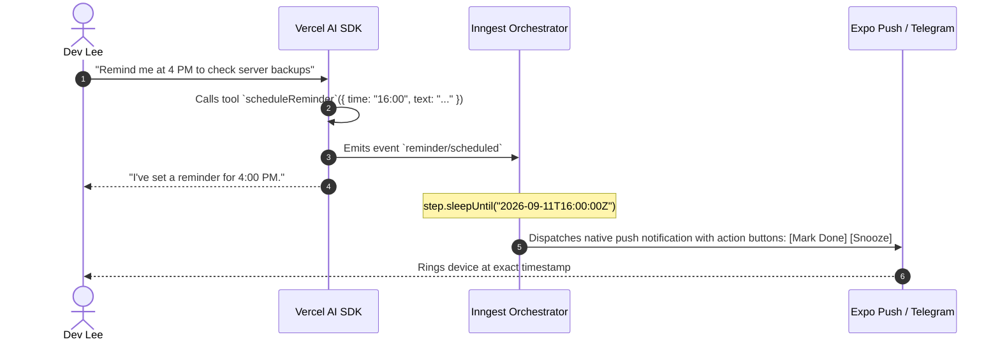
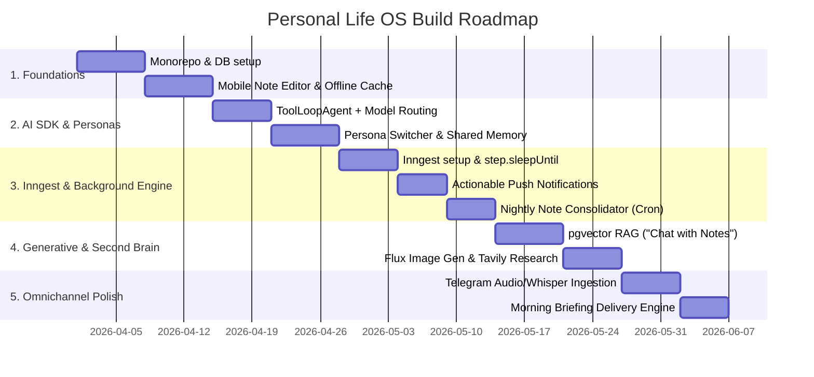

# Personal Daily Routine & Agentic Notes App — Architecture & Setup Blueprint

> **System Name:** Personal Life OS (Second Brain + Proactive Agent Concierge)  
> **Prepared for:** Dev Lee (Lesly Chuo)  
> **Core Agent Engine:** **Vercel AI SDK (`ai` v7 + `@ai-sdk/react`)**  
> **Background & Scheduling Engine:** **Inngest**  
> **Status:** Finalized Architectural Specification  
> **Date:** March 2026  

---

## 1. Executive Summary & Core Tech Stack

This blueprint outlines a unified personal operating system designed for everyday routines, multi-persona guidance, deep research, generative media, omnichannel communication, and an agentic second-brain notes repository.

```
┌─────────────────────────────────────────────────────────────────────────┐
│                           CLIENT APPLICATIONS                           │
│   Expo Mobile App (iOS & Android)     │     Next.js Web / Desktop PWA   │
│   (Voice memos, widgets, push alerts) │     (Dual-pane canvas & notes)  │
└────────────────────────────────────┬────────────────────────────────────┘
                                     │
┌────────────────────────────────────▼────────────────────────────────────┐
│                  CORE AGENT ENGINE: VERCEL AI SDK                       │
│   • ToolLoopAgent architecture with dynamic persona instructions        │
│   • Sub-second token streaming via @ai-sdk/react (useChat)              │
│   • Inline notes ghostwriter & generative UI action cards               │
└───────────────────┬─────────────────────────────────┬───────────────────┘
                    │                                 │
┌───────────────────▼─────────────────┐   ┌───────────▼───────────────────┐
│     BACKGROUND & SCHEDULING         │   │      PERSISTENCE LAYER        │
│          (INNGEST)                  │   │    (POSTGRESQL + PGVECTOR)    │
│ • step.sleepUntil (Reminders/Alerts)│   │ • Notes & Semantic Chunks     │
│ • Cron routines (Morning & Night)   │   │ • Central Episodic Memories   │
│ • Deep web research & doc pipelines │   │ • Daily Habits & Metrics      │
└───────────────────┬─────────────────┘   └───────────────────────────────┘
                    │
┌───────────────────▼─────────────────────────────────────────────────────┐
│                       OMNICHANNEL BRIDGES                               │
│   Telegram (Audio/Text)  │  Expo Push Alerts  │  Twilio SMS  │  Resend  │
└─────────────────────────────────────────────────────────────────────────┘
```

### The Definitive Tech Stack

| Layer | Technology Choice | Functionality & Rationale |
| :--- | :--- | :--- |
| **Agent Framework** | **Vercel AI SDK (`ai` v7)** | Direct control over streaming, typed tool calls, inline text transformations, and `@ai-sdk/react` client hooks. |
| **Task Scheduling & Jobs** | **Inngest** | Serverless durable execution for reminders (`step.sleepUntil`), cron routines, and AI rate-limit resilience. |
| **Mobile Client** | **Expo (React Native)** | Instant mobile capture, lock-screen widgets, background audio recording, and actionable push notifications. |
| **Web Client** | **Next.js 16 (App Router)** | Fullscreen desktop Markdown canvas, split-view note editor, and serverless API gateway. |
| **Database & Vectors** | **PostgreSQL + `pgvector`** (Neon / Supabase) | Relational integrity for daily logs + hybrid search (dense embeddings + BM25 full-text). |
| **AI Gateway** | **OpenRouter / AI Gateway** | Unified interface for Claude 3.7, Gemini 2.5 Flash, Flux, and OpenAI embeddings under one API key. |

---

## 2. Best-in-Class AI Services Matrix

| Domain | Recommended Provider / Model | Primary Use Case |
| :--- | :--- | :--- |
| **Primary Reasoning & Coaching** | **Claude 3.7 Sonnet** | Deep personal coaching, financial analysis, tone nuance, structured JSON tool execution. |
| **Fast Triage & Entity Extraction** | **Gemini 2.5 Flash** / **GPT-4.1-mini** | Sub-second intent classification, note auto-tagging, and voice memo summarization. |
| **Speech-to-Text** | **Groq Whisper Large v3** | Real-time audio transcription (<300ms latency for a 60-second voice dump). |
| **Voice Output (Agent TTS)** | **ElevenLabs** | Hyper-realistic conversational audio for morning briefings and voice responses. |
| **Embeddings (Second Brain)** | **OpenAI `text-embedding-3-small`** | 1536-dimensional semantic clustering for personal notes and chat history. |
| **Deep Web Research** | **Tavily AI** + **Firecrawl** | Clean, ad-free, markdown-formatted web search and deep multi-source page extraction. |
| **Image Generation** | **Flux 1.1 Pro** (via fal.ai / Replicate) | Photorealistic visuals, diagrams, and high-fidelity typography rendering. |

---

## 3. Core Capabilities

### 3.1 Multi-Persona Conversational System

Rather than maintaining isolated chatbots, all personas share a **Central Episodic Memory Graph** while applying specialized system prompts:

* **Work & Engineering**: Code reviews, architecture decisions, GitHub/terminal sandboxing, task breakdown.
* **Finance & Wealth**: Cash flow tracking, expense categorization, runway projection, investment logs.
* **Sport & Fitness**: Progressive overload logging, workout routines, calorie/macro tracking, recovery notes.
* **Life Coach & Habits**: Stoic reflections, cognitive bias checking, daily priority enforcement.
* **Creative & Fun**: Descriptive fiction, brainstorming, roleplay, humor.
* **Relationships**: Social CRM, important dates, notes on people, follow-up reminders.

```
                      ┌────────────────────────────────────────┐
                      │    Central Shared Memory (Postgres)    │
                      │  (Goals, Biometrics, Projects, Net     │
                      │   Worth, Daily Habits, Personal Rules) │
                      └───────────────────┬────────────────────┘
                                          │
         ┌───────────────┬────────────────┼───────────────┬───────────────┐
         ▼               ▼                ▼               ▼               ▼
     [Work]          [Finance]        [Fitness]        [Coach]         [Creative]
```

### 3.2 Agentic "Super-Charged" Notes App

1. **Passive Entity Extraction**:
   - Every note saved automatically triggers a background Inngest job:
     - **Tasks / TODOs** $\rightarrow$ Synced to the personal task table.
     - **Dates / Deadlines** $\rightarrow$ Schedules proactive system reminders.
     - **People / Orgs** $\rightarrow$ Connected to relational contact records.
2. **Semantic Auto-Backlinks**:
   - Eliminates tedious manual `[[wiki-linking]]`. The system uses vector similarity to surface related thoughts, past meetings, and journal entries in a "Connected Context" drawer.
3. **Chat With Your Life (RAG 2.0)**:
   - Query your personal archives naturally: *"What exercises caused knee pain last summer?"* or *"Summarize all decisions made on Project X in October."*
4. **Inline Ghostwriter**:
   - Slash-command palette inside notes: `/expand`, `/extract-action-items`, `/rephrase-for-client`.

### 3.3 Task Scheduling, Reminders & Daily Background Routines

Handled via **Inngest durable execution**:



#### Automated Daily Routines:
* **Nightly Consolidator (11:00 PM)**:
  - Scans today's unorganized notes and audio transcripts.
  - Formats daily notes into structured bullets.
  - Updates habit compliance in `daily_logs`.
* **Morning Executive Brief (6:30 AM)**:
  - Consolidates Google/Apple Calendar events, top 3 priority tasks, and fitness target.
  - Delivers via push notification, Telegram message, and an optional 60-second ElevenLabs audio brief.

### 3.4 Omnichannel Communications

* **Telegram Bot**: Send quick audio memos while walking $\rightarrow$ Transcribed via Groq Whisper in 200ms $\rightarrow$ Appended directly to today's Daily Inbox note.
* **Expo Push Notifications**: Delivers actionable alerts directly to the phone lock screen.
* **Email Forwarding (Resend)**: Forward receipts or newsletters to `inbox@yourdomain.me` $\rightarrow$ Agent extracts key data into Finance or Knowledge notes.
* **Twilio SMS**: Lightweight fallback for urgent alerts when data connectivity is offline.

---

## 4. Complete Database Schema (PostgreSQL + pgvector)

```sql
-- Extensions
CREATE EXTENSION IF NOT EXISTS vector;
CREATE EXTENSION IF NOT EXISTS "uuid-ossp";

-- 1. Notes & Second Brain
CREATE TABLE notes (
  id UUID PRIMARY KEY DEFAULT gen_random_uuid(),
  title TEXT NOT NULL DEFAULT 'Untitled',
  content TEXT NOT NULL,
  summary TEXT,
  folder TEXT DEFAULT 'inbox',
  tags TEXT[] DEFAULT '{}',
  is_pinned BOOLEAN DEFAULT false,
  is_archived BOOLEAN DEFAULT false,
  created_at TIMESTAMPTZ DEFAULT now(),
  updated_at TIMESTAMPTZ DEFAULT now()
);

-- Note Vector Embeddings
CREATE TABLE note_chunks (
  id UUID PRIMARY KEY DEFAULT gen_random_uuid(),
  note_id UUID NOT NULL REFERENCES notes(id) ON DELETE CASCADE,
  chunk_index INT NOT NULL,
  content TEXT NOT NULL,
  embedding vector(1536) NOT NULL,
  created_at TIMESTAMPTZ DEFAULT now()
);
CREATE INDEX note_chunks_vec_idx ON note_chunks USING hnsw (embedding vector_cosine_ops);

-- 2. Central Episodic Memory (Cross-Persona Knowledge)
CREATE TABLE personal_memories (
  id UUID PRIMARY KEY DEFAULT gen_random_uuid(),
  domain TEXT NOT NULL, -- 'work', 'finance', 'fitness', 'habits', 'relationships'
  statement TEXT NOT NULL,
  importance INT DEFAULT 3, -- 1 to 5 scale
  source_note_id UUID REFERENCES notes(id) ON DELETE SET NULL,
  created_at TIMESTAMPTZ DEFAULT now(),
  updated_at TIMESTAMPTZ DEFAULT now()
);

-- 3. Scheduled Tasks & Reminders
CREATE TABLE reminders (
  id UUID PRIMARY KEY DEFAULT gen_random_uuid(),
  title TEXT NOT NULL,
  fire_at TIMESTAMPTZ NOT NULL,
  channel TEXT NOT NULL DEFAULT 'push', -- 'push', 'telegram', 'sms'
  status TEXT NOT NULL DEFAULT 'PENDING', -- 'PENDING', 'SENT', 'SNOOZED', 'COMPLETED'
  recurrence TEXT, -- 'daily', 'weekly', null
  created_at TIMESTAMPTZ DEFAULT now()
);

-- 4. Chat Threads & Messages
CREATE TABLE conversations (
  id UUID PRIMARY KEY DEFAULT gen_random_uuid(),
  persona TEXT NOT NULL, -- 'work', 'finance', 'fitness', 'coach', 'creative'
  title TEXT DEFAULT 'New Conversation',
  channel TEXT DEFAULT 'web',
  created_at TIMESTAMPTZ DEFAULT now(),
  updated_at TIMESTAMPTZ DEFAULT now()
);

CREATE TABLE messages (
  id UUID PRIMARY KEY DEFAULT gen_random_uuid(),
  conversation_id UUID NOT NULL REFERENCES conversations(id) ON DELETE CASCADE,
  role TEXT NOT NULL, -- 'user', 'assistant', 'system', 'tool'
  content TEXT,
  parts JSONB,
  created_at TIMESTAMPTZ DEFAULT now()
);

-- 5. Daily Habit & Routine Tracker
CREATE TABLE daily_logs (
  id UUID PRIMARY KEY DEFAULT gen_random_uuid(),
  log_date DATE NOT NULL UNIQUE DEFAULT CURRENT_DATE,
  mood INT, -- 1-10
  energy INT, -- 1-10
  habits_completed JSONB DEFAULT '{}',
  metrics JSONB DEFAULT '{}', -- { "workout": true, "calories": 2400, "weight_kg": 78.5 }
  daily_reflection TEXT,
  created_at TIMESTAMPTZ DEFAULT now()
);
```

---

## 5. Repository Monorepo Structure

```
personal-os/
├── apps/
│   ├── mobile/                    # Expo Mobile App (iOS / Android)
│   │   ├── app/
│   │   │   ├── (tabs)/
│   │   │   │   ├── index.tsx      # Today Dashboard (Routine, Habits, Reminders)
│   │   │   │   ├── notes/         # Fast offline note editor
│   │   │   │   ├── chat/          # Persona chat interface (AI SDK useChat)
│   │   │   │   └── routines/      # Fitness & finance logs
│   │   │   └── _layout.tsx
│   │   └── package.json
│   │
│   └── web/                       # Next.js 16 Web Dashboard & Inngest Runner
│       ├── app/
│       │   ├── api/
│       │   │   ├── chat/route.ts  # Vercel AI SDK ToolLoopAgent endpoint
│       │   │   ├── inngest/       # Inngest background job webhook handler
│       │   │   └── webhooks/      # Telegram & Twilio endpoints
│       │   ├── notes/             # Fullscreen desktop Markdown/Canvas editor
│       │   └── layout.tsx
│       └── package.json
│
├── packages/
│   ├── agent-core/                # Shared Vercel AI SDK Logic
│   │   ├── personas/              # System instructions per persona
│   │   ├── tools/                 # Tool definitions (RAG, reminders, image gen, research)
│   │   └── router.ts              # Intent classifier
│   │
│   ├── database/                  # Shared Prisma / PG Client
│   │   ├── schema.prisma
│   │   └── index.ts
│   │
│   └── inngest-client/            # Shared Inngest Client & Job Handlers
│       ├── functions/
│       │   ├── reminders.ts       # step.sleepUntil reminder dispatchers
│       │   ├── consolidator.ts    # Nightly 11 PM note & habit processing
│       │   └── deep-research.ts   # Multi-source web research crawler
│       └── client.ts
│
└── package.json
```

---

## 6. Implementation Roadmap



### Phase 1: Core Storage & Note Editor (Week 1–2)
- Set up Turborepo with Expo + Next.js + PostgreSQL (`pgvector`).
- Build responsive rich-text note editor supporting fast capture on mobile.

### Phase 2: Vercel AI SDK Multi-Persona Engine (Week 3–4)
- Implement `ToolLoopAgent` with persona definitions (Work, Finance, Fitness, Coaching, Creative).
- Implement the `personal_memories` table for shared cross-persona recall.

### Phase 3: Inngest Background Jobs & Reminders (Week 5–6)
- Connect Inngest to handle natural language reminder scheduling (`step.sleepUntil`).
- Wire up Expo Push Notifications with interactive action buttons (`Mark Done`, `Snooze`).
- Configure 11:00 PM nightly routine for habit and note consolidation.

### Phase 4: Second Brain RAG & Generative Tools (Week 7–8)
- Implement real-time note vectorization (`openai/text-embedding-3-small`).
- Integrate Tavily AI for deep web research and Flux 1.1 Pro for image generation.

### Phase 5: Omnichannel Ingestion (Week 9)
- Deploy Telegram Bot webhook to accept voice memos on the go $\rightarrow$ transcribed in 200ms via Groq Whisper $\rightarrow$ filed automatically into your daily notes.
- Launch automated morning briefing delivered via push notification and ElevenLabs voice.
