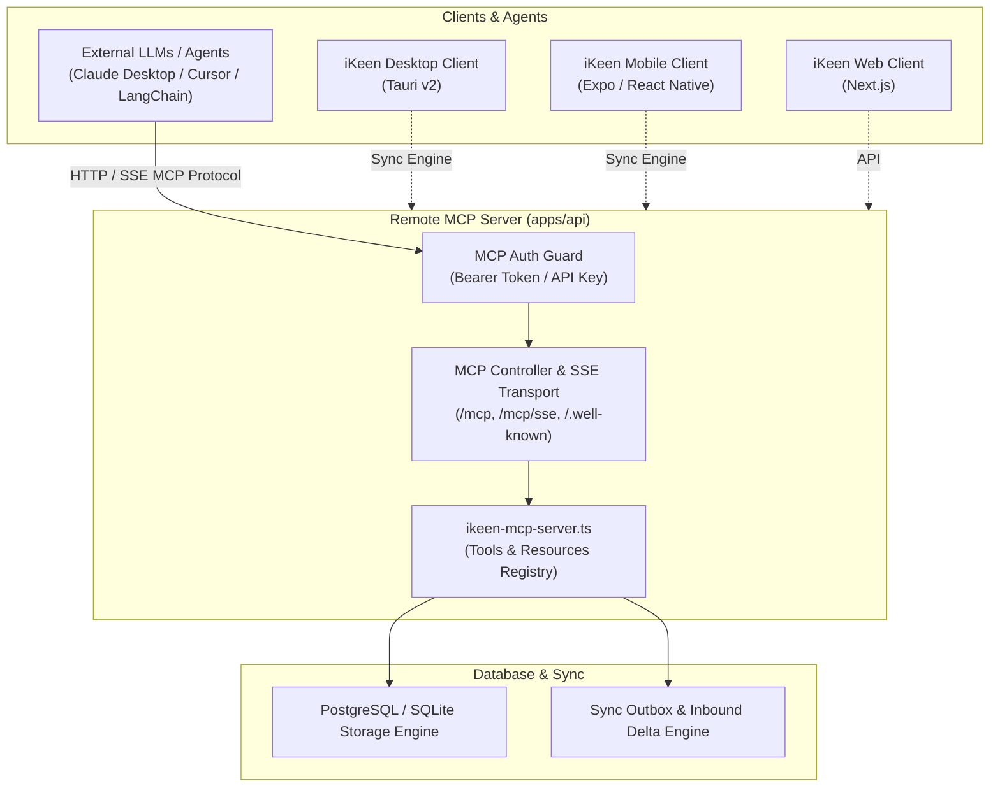

# Model Context Protocol (MCP) Architecture

## 1. Overview & Strategy

iKeen implements a **centralized Remote MCP Server** architecture. 

Rather than running fragmented local MCP child processes or sidecars inside client apps (desktop, mobile, web), all AI agents, IDE extensions (Cursor, VS Code), and external LLMs (Claude Desktop, custom agents) interface directly with the **iKeen API MCP Server** hosted in [`apps/api/src/modules/mcp`](file:///c:/Users/Dev%20Lee/Documents/@DevLee/mobile/ikeen/apps/api/src/modules/mcp).



---

## 2. Why Remote MCP Over Client Sidecars

1. **Single Source of Truth**: The central backend guarantees database consistency across all platforms (iOS, Android, macOS, Windows, Linux, Web). Local client sidecars risk divergent state and partial outbox states.
2. **Zero Client Dependencies**: Client apps remain lean, lightweight, and fast. Users do not need Python, Node.js, or bundled secondary binaries installed on their desktop or mobile devices.
3. **Enterprise Security & Authentication**: Access is guarded by [`mcp-auth.guard.ts`](file:///c:/Users/Dev%20Lee/Documents/@DevLee/mobile/ikeen/apps/api/src/modules/mcp/guards/mcp-auth.guard.ts) with strict user isolation, eliminating the need to expose raw local file system pipes or unauthenticated stdio streams.
4. **Universal Agent Interoperability**: Any external AI tool (e.g. Claude Desktop, Cursor, OpenAI Agents) can connect to `https://api.ikeen.app/mcp` using standard SSE or HTTP transports.

---

## 3. Remote Server Implementation Reference

* **Main Server Implementation**: [`apps/api/src/modules/mcp/ikeen-mcp-server.ts`](file:///c:/Users/Dev%20Lee/Documents/@DevLee/mobile/ikeen/apps/api/src/modules/mcp/ikeen-mcp-server.ts)
* **Controllers & Discovery**:
  * [`apps/api/src/modules/mcp/controllers/mcp.controller.ts`](file:///c:/Users/Dev%20Lee/Documents/@DevLee/mobile/ikeen/apps/api/src/modules/mcp/controllers/mcp.controller.ts)
  * [`apps/api/src/modules/mcp/controllers/mcp-well-known.controller.ts`](file:///c:/Users/Dev%20Lee/Documents/@DevLee/mobile/ikeen/apps/api/src/modules/mcp/controllers/mcp-well-known.controller.ts)
* **Authentication Guard**: [`apps/api/src/modules/mcp/guards/mcp-auth.guard.ts`](file:///c:/Users/Dev%20Lee/Documents/@DevLee/mobile/ikeen/apps/api/src/modules/mcp/guards/mcp-auth.guard.ts)

---

## 4. Preserved Knowledge Graph & Backlink Logic

The following graph traversal and backlink discovery algorithms were designed for iKeen note representations and are preserved here for future migration into the remote [`ikeen-mcp-server.ts`](file:///c:/Users/Dev%20Lee/Documents/@DevLee/mobile/ikeen/apps/api/src/modules/mcp/ikeen-mcp-server.ts):

### A. Note Knowledge Graph Traversal
Extracts nodes (notes, folders, tags) and directed edges (wikilinks `[[Target Note]]`, folder containment, and tag relationships):

```typescript
// Parsing wikilinks [[Target Title]]
const wikilinkRegex = /\[\[(.*?)\]\]/g;
let match;
while ((match = wikilinkRegex.exec(noteContent)) !== null) {
  const targetTitle = match[1].trim().toLowerCase();
  const targetId = titleToIdMap.get(targetTitle);
  if (targetId && targetId !== note.id) {
    edges.push({ source: note.id, target: targetId, type: 'link' });
  }
}
```

### B. Inbound Backlinks Discovery
Queries all active notes that reference a target note by title:
```sql
SELECT id, title, content, updated_at
FROM notes
WHERE deleted_at IS NULL AND content LIKE '%[[' || :targetTitle || ']]%';
```

### C. Structural Insights Analysis
Analyzes note length, reading duration, outbound references, and flags "orphan" notes (notes with neither inbound nor outbound connections):
```typescript
const isOrphan = outboundLinks.length === 0 && inboundLinksCount === 0;
```
