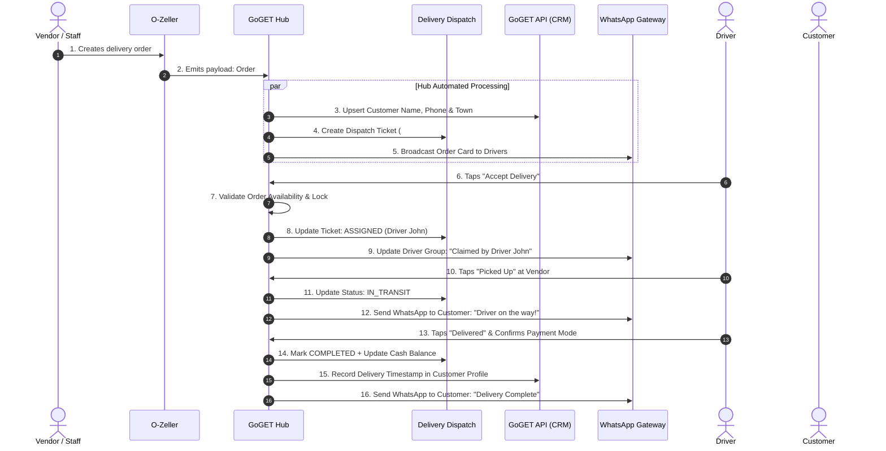

# GoGET Unified Logistics & Operations Integration Proposal

**Document Version:** 1.0  
**Prepared For:** GoGET Management & Operations  
**Scope:** Custom Systems Integration & Workflow Automation  
**Author:** Lesly Chuo
**Email:** lesly@leslychuo.me

---

## 1. Executive Summary

GoGET currently operates a high-touch, responsive delivery business powered by dedicated teams and drivers. However, operational efficiency, scaling capacity, and data accuracy are bottlenecked by **fragmented, independent software systems** and **heavy manual WhatsApp/phone coordination**.

This document outlines a functional, step-by-step custom integration architecture. Instead of immediately forcing a high-friction platform replacement, this proposal connects and automates GoGET's existing tools (**O-Zeller**, **Delivery Dispatch**, and **GoGet API / GoChat**) into a synchronized, intelligent workflow engine, laying the groundwork for a streamlined Driver App and self-service portals.

---

## 2. Current State vs. Pain Points

```
[Vendor / Team] ──> Creates Order on O-Zeller / WhatsApp
                           │
                           ▼ (Manual WhatsApp Text)
                  [WhatsApp Dedicated Group]
                           │
             ┌─────────────┴─────────────┐
             ▼                           ▼
      [Driver Picks Up]           [Manual Data Entry]
  (Calls Vendor & Customer)              │
             │                           ├─> Delivery Dispatch (Stats/Drivers)
             ▼                           └─> GoGet API (Client Contacts/CRM)
     Drop-off & Payment
 (Cash to Driver or Vendor)
```

### Existing Infrastructure Breakdown
1. **O-Zeller (Order & Stock Management)**
   - *Role:* Creation of deliveries by internal team or vendors; inventory/stock product catalog.
   - *Current Mechanism:* Submitting an order produces a formatted WhatsApp text message sent to dispatch/driver groups.
2. **Delivery Dispatch (Operational Monitoring)**
   - *Role:* Tracks driver performance, delivery volumes, and historical statistics.
   - *Current Gap:* Order assignment and status updates are back-filled manually by admins long after deliveries conclude on WhatsApp.
3. **GoGet API / GoChat (Customer Contacts & Broadcasts)**
   - *Role:* Custom CRM admin holding customer/vendor phone directories and advertisement broadcasting source.
   - *Current Gap:* Client contact data is manually keyed in from WhatsApp records.

### Critical Operational Bottlenecks
- **Double/Triple Manual Data Entry:** Admins manually extract WhatsApp messages to update Delivery Dispatch and GoGet API contacts.
- **Unstructured Driver Claiming:** Drivers "pick" orders in a shared group, leading to potential race conditions, missed deliveries, or disputed assignments.
- **Unverified Payment Reconciliation:** Cash on Delivery (COD) collected by drivers vs. payments made directly to vendors requires manual chat audit logs.
- **Zero Real-Time Tracking for Customers & Vendors:** Status updates rely solely on manual phone calls.
- **Too Much Manual Typing:** Every single order has to be copied into WhatsApp, then typed into Delivery Dispatch, and then typed into GoGET API.
- **Chaos in WhatsApp Groups:** Drivers have to monitor noisy chat groups to grab orders. It is easy for jobs to be missed, taken by the wrong person, or delayed.
- **Too Many Phone Calls:** Customers have no idea when their package is coming, so they call the vendor. The vendor calls dispatch. Dispatch calls the driver.
- **Unclear Cash & Payment Tracking:** When customers pay cash to a driver versus paying directly to the vendor, staff have to read back through old WhatsApp messages at the end of the day to figure out who owes what.

---

## 3. The Solution: A Connected GoGET System

Instead of three isolated apps glued together with manual work, we propose **connecting GoGET into one seamless operational platform**.

Here is how daily operations will work for each person in the company:

### A. For Vendors & Senders
- They open their order screen, select items from their stock, and tap **"Request Delivery"**.
- **Their job is finished.** No need to take screenshots, write messages, or post into a WhatsApp group.

### B. For the Dispatch Team
- The new delivery **instantly appears on the dispatch dashboard**.
- Dispatchers can see all active orders, which drivers are available, and what is currently on the road—with **zero manual typing**.

### C. For Drivers
- Instead of fighting over jobs in a noisy group chat, drivers receive clear, designated delivery cards on their device.
- **One-Tap Google Maps Navigation:** Drivers tap **"Navigate to Vendor"** or **"Navigate to Customer"** to launch turn-by-turn Google Maps directions immediately—ending blind phone calls asking for directions.
- The driver simply taps through three simple buttons:
  1. **"Accept Delivery"** (locks the delivery so no other driver takes it).
  2. **"Picked Up"** (confirms they have the package from the vendor).
  3. **"Delivered"** (confirms drop-off and selects: *"Cash Collected by Driver"* or *"Paid Directly to Vendor"*).

### D. For Customers
- As soon as the driver marks an order as "Picked Up", the customer automatically receives a WhatsApp message:  
  *“Hello! Your GoGET driver has picked up your package from [Vendor] and is on the way.”*
- Phone calls stop, and customer trust goes up.

### E. For Management & Accounting
- Every customer contact and delivery record is automatically saved for marketing and future broadcasts.
- At the end of every day, management can see an exact report: total deliveries completed, driver performance, and total cash collected.

---

## 4. The Automatic Trigger System (How the Pieces Talk to Each Other)

To make this work without throwing away GoGET’s existing tools, we introduce an **Automatic Trigger System**.

Think of this like an **automatic digital relay race**: whenever something happens in one app, it immediately sets off the next action in the other apps automatically.

```
       [ ACTION ]                                   [ AUTOMATIC RESULTS ]
 
 Vendor creates order       ──►   1. Delivery ticket automatically appears in Dispatch.
 in O-Zeller                      2. Customer phone & address automatically saved in GoGET API.
                                  3. Driver group/feed receives immediate delivery notification.

 Driver taps "Picked Up"    ──►   1. Dispatch dashboard updates to "Out for Delivery".
                                  2. Customer gets automatic WhatsApp alert: "Driver on the way!"

 Driver taps "Delivered"    ──►   1. Job marked complete in Dispatch stats.
                                  2. Cash collected balance logged for the driver.
                                  3. Customer receives delivery confirmation.
```

### Why this is a huge win for GoGET:
- It connects to GoGET's current systems (**O-Zeller**, **Delivery Dispatch**, and **GoGET API**) immediately.
- It works 24/7 in the background without needing staff to copy text or click "sync".

---

## 5. What Problems This Solves (Before vs. After)

| Daily Challenge | How GoGET Works Today (Manual) | How GoGET Will Work (Connected) |
| :--- | :--- | :--- |
| **Entering an Order** | Order is created in O-Zeller, then manually copied into WhatsApp. | Order created once; instantly flows to dispatch and drivers automatically. |
| **Assigning Drivers** | Posted into a group chat; drivers grab it or messages get buried. | Clear, structured assignment with single-tap acceptance. |
| **Driver Navigation** | Driver repeatedly calls vendor/customer for landmarks and directions. | **Integrated Google Maps:** One tap launches exact turn-by-turn navigation. |
| **Customer Updates** | Customer calls vendor $\rightarrow$ vendor calls dispatch $\rightarrow$ dispatch calls driver. | Customer automatically receives an automated WhatsApp alert on pickup. |
| **Logging Delivery Stats** | Staff manually type completed deliveries into Delivery Dispatch later. | Delivery Dispatch updates live in real-time as drivers tap their status. |
| **Saving Customer Contacts** | Staff manually re-type client phone numbers into GoGET API. | 100% of customer names, towns, and phone numbers are saved automatically. |
| **Cash on Delivery (COD)** | Hard to track; staff scroll back through chat messages to verify cash. | Driver confirms payment collection on delivery; daily totals calculate automatically. |

---

## 6. Step-by-Step Rollout Plan

To ensure zero downtime and make it easy for staff and drivers to adapt, we roll this out in three smooth steps:

### Step 1: Connect the Apps & Stop Manual Data Entry (Immediate Relief)
- Connect O-Zeller, Delivery Dispatch, and GoGET API through the Automatic Trigger System.
- When an order is created, it automatically logs into Dispatch, saves the customer in GoGET API, and sends a clean delivery message to the drivers.
- **Result:** Staff stop copy-pasting immediately; zero lost customer contacts.

### Step 2: Driver Interactive Screen (Operational Control)
- Provide drivers with a simple, user-friendly screen to accept orders, see addresses, use Google Maps navigation, and tap status updates (Accepted, Picked Up, Delivered).
- **Result:** Group chat confusion stops; dispatch sees live driver progress.

### Step 3: Customer Alerts & Cash Accounting (Peace of Mind)
- Turn on automatic WhatsApp updates for customers upon pickup and delivery.
- Turn on daily cash-collected reporting to clearly separate driver cash collections from vendor-paid orders.
- Turn on daily custom contact sync and messaging broadcast.
- **Result:** Inbound customer support calls drop by 70%; daily financial reconciliation takes minutes instead of hours.

---

## 7. Summary of Business Benefits

1. **Save Hours of Staff Time Daily:** Eliminates three separate stages of manual copy-pasting.
2. **Handle More Deliveries With Same Team:** GoGET can double or triple order volume without needing to hire more dispatch admins.
3. **Happy Customers & Vendors:** Vendors have zero hassle requesting pickups, and customers get proactive status updates.
4. **Clean Finances & Records:** Clear accountability for every delivery, every cash payment, and a growing database of customer contacts for future sales campaigns.

---

# PART II: Technical Architecture & Data Flow Specification

## 8. The Integration Architecture: The Hub-and-Spoke Model

To connect the three existing apps without modifying their core internals or creating fragile point-to-point connections, the system uses a **Central Integration Hub (Middleware)**.

```
                             ┌───────────────────────────────┐
                             │           O-ZELLER            │
                             │ (Order & Stock Web Dashboard) │
                             └───────────────┬───────────────┘
                                             │ 1. Order Created Webhook
                                             ▼
                             ┌───────────────────────────────┐
                             │      GoGET INTEGRATION HUB    │
                             │   - Event Router & Validator  │
                             │   - Job Queue (Retries/Buffer)│
                             │   - Driver Assignment Engine  │
                             └───────┬───────┬───────┬───────┘
                                     │       │       │
            ┌────────────────────────┘       │       └────────────────────────┐
            │ 2. Sync Customer               │ 3. Create Ticket               │ 4. Dispatch Alert
            ▼                                ▼                                ▼
┌────────────────────────┐      ┌────────────────────────┐      ┌────────────────────────┐
│   GoGET API / GoChat   │      │   DELIVERY DISPATCH    │      │    DRIVER WORKFLOW     │
│   (Customer CRM & WA)  │      │  (Fleet Stats & Queue) │      │  (Interactive Screen)  │
└────────────────────────┘      └────────────────────────┘      └────────────────────────┘
```

### Core Responsibilities of the Integration Hub:
- **Zero-Data Loss Queue:** If the WhatsApp API or Delivery Dispatch is temporarily slow or down, orders are safely queued and retried automatically.
- **Single Source of Truth:** Validates order IDs and timestamps across all systems.
- **Concurrency Control:** Ensures that when multiple drivers see an order, only the **first driver to tap Accept** receives the assignment (eliminating duplicate claims).

---

## 9. End-to-End Data Flow (The Order Lifecycle)



---

## 10. Stage-by-Stage Data Movement

### Stage 1: Order Ingestion & Auto-Populate
1. **Trigger:** An order is finalized in O-Zeller.
2. **Payload from O-Zeller to Hub:**
   ```json
   {
     "order_id": "GGT-1042",
     "vendor": { "id": "V-08", "name": "Fresh Mart", "phone": "0541234567" },
     "customer": { "name": "Ama Serwaa", "phone": "0249876543", "town": "East Legon", "address": "House 14, Near Shell" },
     "items": [
       { "name": "Cooking Oil 5L", "quantity": 1, "price": 140 },
       { "name": "Rice 5kg", "quantity": 2, "price": 120 }
     ],
     "total_amount": 380,
     "payment_type": "CASH_ON_DELIVERY"
   }
   ```
3. **Automated Actions by the Hub:**
   - **Calls GoGET API:** Sends customer details to `/api/contacts/upsert`.
   - **Calls Delivery Dispatch:** Sends ticket to `/api/dispatch/orders` with status `PENDING`.
   - **Sends Driver Notification:** Posts order summary card into the driver interface/channel.

---

### Stage 2: Driver Claiming & Lockout
1. **Trigger:** Driver taps **"Accept Delivery"**.
2. **Payload to Hub:**
   ```json
   {
     "order_id": "GGT-1042",
     "driver_id": "DRV-04",
     "driver_name": "Kofi Mensah",
     "timestamp": "2026-11-15T15:30:00Z"
   }
   ```
3. **Automated Actions by the Hub:**
   - **Atomic Check:** Verifies order status is still `PENDING`.
   - If available, sets status to `ASSIGNED` to `DRV-04`. If already claimed by another driver, replies with *"Already Claimed"*.
   - Updates **Delivery Dispatch** with driver assignment and acceptance timestamp.
   - **Generates Google Maps Routing Links:** Returns pre-formatted deep-links (`google.navigation:q=...` / `https://www.google.com/maps/dir/?api=1&destination=...`) for one-tap vendor pickup and customer drop-off.

---

### Stage 3: Pickup & Real-Time Customer Alert
1. **Trigger:** Driver arrives at vendor and taps **"Picked Up"**.
2. **Automated Actions by the Hub:**
   - Updates **Delivery Dispatch** status to `IN_TRANSIT` (starts travel time tracker).
   - Calls **GoGET API (WhatsApp Gateway)** to send an automated template message to customer `0249876543`:
     > *“Hello Ama! Your GoGET driver Kofi Mensah has picked up your package from Fresh Mart and is heading to your address in East Legon.”*

---

### Stage 4: Delivery Confirmation & Cash Reconciliation
1. **Trigger:** Driver hands over package and taps **"Delivered"**.
2. **Driver Input Prompts:**
   - Payment status confirmation:
     - `[✓] Paid to Driver (Cash / MoMo to Driver)` $\rightarrow$ Amount: GHS 380
     - `[ ] Paid to Vendor Directly`
3. **Payload to Hub:**
   ```json
   {
     "order_id": "GGT-1042",
     "driver_id": "DRV-04",
     "status": "DELIVERED",
     "payment_collected_by": "DRIVER",
     "amount_collected": 380,
     "timestamp": "2026-11-15T16:05:00Z"
   }
   ```
4. **Automated Actions by the Hub:**
   - **Delivery Dispatch:** Marks order `COMPLETED`, logs total turnaround time (35 mins).
   - **Cash Ledger:** Credits Driver Kofi’s daily cash-in-hand balance by GHS 380 for end-of-day settlement.
   - **GoGET API:** Records order completion in Ama Serwaa's customer profile.
   - **WhatsApp Gateway:** Sends delivery receipt to customer:
     > *“Your delivery GGT-1042 from Fresh Mart has been completed. Thank you for choosing GoGET!”*

---

## 11. How the Existing Apps Connect (Integration Methods)

| Existing App | How Data Leaves the App (Inbound to Hub) | How Data Enters the App (Outbound from Hub) |
| :--- | :--- | :--- |
| **O-Zeller** | Outgoing Webhook on "Save/Create Order" button, OR direct Database Trigger / Polling on the orders table. | Read-only from Hub; stock updates remain inside O-Zeller. |
| **Delivery Dispatch** | Receives driver status updates from the Hub. | Standard REST API endpoint `/api/orders` to auto-insert orders and update driver metrics. |
| **GoGET API / GoChat** | Provides WhatsApp API connectivity and broadcasts. | REST API endpoints `/api/contacts` (for contact saving) and `/api/messages/send` (for automated customer alerts). |

---

## 12. Delivery State Machine

Every order moves through a strict, transparent set of milestones:

$$\text{CREATED (O-Zeller)} \longrightarrow \text{PENDING (Dispatch)} \longrightarrow \text{ASSIGNED (Driver)} \longrightarrow \text{IN\_TRANSIT (Pickup)} \longrightarrow \text{DELIVERED (Complete)}$$

- **Failed or Cancelled Deliveries:** If a customer is unreachable, the driver taps *"Customer Unreachable"*. The Hub automatically updates Dispatch and notifies both vendor and dispatchers immediately.

---

## 13. Security, Reliability & Data Safety

1. **Authentication:** All communication between the Hub, O-Zeller, Dispatch, and GoGET API is secured with API Keys / Bearer Tokens.
2. **Duplicate Prevention:** Unique `order_id` deduplication ensures no order is ever logged twice or sent to drivers multiple times.
3. **Offline Buffer:** If WhatsApp API or Dispatch has an outage, the Hub buffers actions in an internal queue and delivers them the second the service recovers.

---

# PART III: Technical Pathways, Strategic Options & Conclusion

## 14. Strategic Decision: Choosing the Driver & Operations Interface

While the **GoGET Central Integration Hub** powers the logic, order queues, and data synchronization across O-Zeller, Delivery Dispatch, and GoGET API, management has **two clear technical paths** for deploying the driver workflow interface:

```
                              ┌───────────────────────────────────┐
                              │     GoGET CENTRAL INTEGRATION     │
                              │    (Shared APIs, Queue & Hub)     │
                              └─────────────────┬─────────────────┘
                                                │
                 ┌──────────────────────────────┴──────────────────────────────┐
                 ▼                                                             ▼
     [ OPTION 1: PWA WEB APP ]                                    [ OPTION 2: NATIVE APPS ]
    • Instant URL link launch                                    • Full background GPS tracking
    • Zero app store install friction                            • Loud native sound & wake-up alerts
    • Works on all budget devices                                • Offline cache & biometric log-in
    • Lowest cost & fastest rollout                              • Enterprise fleet brand presence
```

---

### Option 1: The Progressive Web App (PWA) Route
*A high-speed, lightweight mobile web application that drivers open directly in their browser and install to their home screen with one tap.*

- **How it works:** 
  Drivers receive a personalized link via WhatsApp (e.g., `driver.goget.com`). When opened, their phone prompts them to *"Add GoGET to Home Screen"*. It opens and feels like a native app with a full-screen experience and zero browser address bars.
- **Key Advantages:**
  1. **Zero App Store Barrier:** No Google Play Store or Apple App Store accounts, download limits, or review delays. Updates are instant and automatic.
  2. **Budget-Device Friendly:** Uses less than 5 MB of device memory; runs smoothly on low-end smartphones common among delivery drivers.
  3. **Fastest Time to Market:** Can be developed, tested, and deployed to the entire driver fleet in **1 to 2 weeks**.
  4. **Google Maps Integration:** Includes direct "Navigate" buttons that open the Google Maps app natively on Android and iOS using pre-filled destination coordinates.
- **Trade-offs to Consider:**
  - Background GPS tracking pauses when the phone screen is locked or browser is suspended.
  - Push notifications on older iOS versions require user permissions.
- **Best For:** GoGET's immediate rollout if the priority is **rapid deployment, low cost, and zero driver onboarding resistance**.

---

### Option 2: The Native Mobile App Route (Android / iOS)
*Dedicated, installed mobile applications built with modern cross-platform mobile frameworks (e.g., React Native or Flutter) distributed via direct APK or app stores.*

- **How it works:** 
  Drivers install the official **GoGET Driver App** on their devices. The app runs as a dedicated system service with deep access to phone hardware.
- **Key Advantages:**
  1. **Continuous Real-Time GPS Tracking & Google Maps:** The app broadcasts live driver location even when the phone is locked, embeds Google Maps SDK for in-app navigation routes, and calculates live ETAs for dispatchers.
  2. **High-Priority Audio Alerts:** Can trigger custom, loud ringtones that cut through noisy traffic when a new delivery arrives, ensuring orders are never missed.
  3. **Camera & Offline Stability:** Fast, native camera integration for photo proof-of-delivery (drop-off receipt) and offline caching if mobile data briefly drops.
  4. **Professional Brand Equity:** A polished app on Google Play/App Store solidifies GoGET as a premier logistics brand.
- **Trade-offs to Consider:**
  - Requires drivers to have enough device storage to download and keep the app updated.
  - Higher development effort and 3 to 5 weeks delivery timeline.
- **Best For:** GoGET’s medium-to-long-term fleet control where **live map tracking, hardware alerts, and tight driver monitoring** are non-negotiable.

---

### Recommended Hybrid Pathway
> **Executive Recommendation:** Start with **Option 1 (PWA)** for the immediate pilot to validate the automated driver workflow and eliminate WhatsApp manual copy-pasting within 14 days. Once operations are stabilized and driver adoption is 100%, transition seamlessly to **Option 2 (Native App)** using the exact same backend APIs without altering vendor or dispatch workflows.

---

## 15. Next Paths & Implementation Roadmap

To achieve the primary objective—**orchestrating all GoGET operations into one coherent, scalable platform while integrating existing tools today**—we recommend a clear 3-stage roadmap:

```
[ PHASE 1: Immediate ]          [ PHASE 2: Operational Rollout ]    [ PHASE 3: Long-Term Horizon ]
Backend Hub & Auto-Sync          Driver Workflow & Alerts            Unified GoGET Operating System
─────────────────────────        ────────────────────────────────    ───────────────────────────────
• Deploy Central Hub.            • Roll out chosen interface         • Gradually converge O-Zeller,
• Auto-sync O-Zeller orders        (Option 1 PWA or Option 2 App).     Dispatch & CRM into one unified
  to Dispatch & GoGET API.       • Activate customer WhatsApp          portal & single database.
• Eliminate manual copy-paste.     milestone alerts.                 • Permanent IP ownership for GoGET.
```

### Phase 1: Technical Discovery & API Handshake (Week 1 – 2)
*Goal: Zero-risk connectivity check without interrupting daily deliveries.*
1. **Endpoint & Database Audit:** Inspect O-Zeller, Delivery Dispatch, and GoGET API codebases/databases to confirm webhook hooks, database triggers, or REST endpoints.
2. **Integration Hub Setup:** Deploy the Central Integration Hub in staging to validate payload mapping between O-Zeller orders, Dispatch tickets, and CRM contacts.
3. **WhatsApp Gateway Alignment:** Configure GoChat / WhatsApp Business API connection for automated milestone message delivery.

### Phase 2: Driver Interface Rollout & Pilot (Week 3 – 5)
*Goal: Prove real-world operational speed gains and driver adoption.*
1. **Deploy Driver Interface:** Launch selected Option (PWA or Native App) with a pilot group of 5 trusted drivers.
2. **Automated Order Dispatch:** Test auto-ingestion from O-Zeller into Delivery Dispatch and verify customer milestone alerts on real orders.
3. **Cash Tracking Validation:** Test the end-of-day Cash on Delivery (COD) versus vendor-paid settlement reports against actual cash handed in.

### Phase 3: Gradual Convergence into One Coherent System (Long-Term Horizon)
*Goal: The permanent consolidation of GoGET’s software ecosystem.*
1. While the Integration Hub solves 100% of the manual copy-pasting and coordination chaos today, the long-term goal is to bring the vendor stock catalog, dispatch console, and driver workflows under **one unified codebase and database**.
2. Because the Hub standardizes all data models today, moving to a fully consolidated platform in the future will require **zero data migration headaches and zero operational downtime**.

---

## 15. Conclusion

GoGET has already built a thriving delivery network, strong vendor trust, and an active fleet of drivers. However, the business is currently running on human effort to bridge disconnected software—costing hundreds of hours in manual copy-pasting, chat coordination, and phone calls every month.

By deploying the **GoGET Central Integration Hub** and modernizing the driver experience:
1. **Immediate Relief Today:** O-Zeller, Delivery Dispatch, and GoGET API are instantly synchronized, eliminating manual data entry from day one.
2. **Complete Operational Control:** Drivers gain a clear, structured order flow with automatic customer updates and verified cash tracking.
3. **Flexible Technical Choice:** Management can choose between the rapid, frictionless **PWA Web App** or the full-featured **Native Mobile App** depending on business priorities.
4. **A Clear Path to One Unified Platform:** Transforms fragmented, standalone tools into a single, automated logistics powerhouse capable of scaling order volumes 5x to 10x without adding administrative overhead.

The technology is ready, the integration path is non-disruptive, and the return on investment begins the moment the first order flows automatically from vendor to driver.
