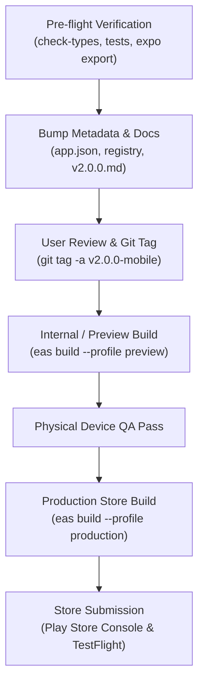

# Release Process & Requirements Standard

This document establishes the official release requirements, semantic versioning policy, pre-flight verification gates, and Git tagging conventions for all applications and packages across the iKeen monorepo.

---

## 1. Versioning Policy (SemVer 2.0.0)

All platforms (`apps/mobile`, `apps/web`, `apps/api`) adhere to strict Semantic Versioning (`MAJOR.MINOR.PATCH`):

* **MAJOR (`X.0.0`)**: 
  - Generational milestones and architectural paradigm shifts (e.g., migrating from flat markdown notes to modular block-based notes in `v2.0.0`).
  - Breaking schema changes that require coordinated client-server migrations.
  - Complete navigation or visual shell redesigns.
* **MINOR (`x.Y.0`)**:
  - Significant new user-facing features (e.g., new block types, audio notes, AI agent skills, export tools).
  - New backward-compatible API endpoints or sync entity handlers.
* **PATCH (`x.y.Z`)**:
  - Bug fixes, performance optimizations, memory leak remediations, and sync conflict hardening.
  - Security patches and dependency updates.

### Build Numbers & App Version Codes
* **Mobile (`apps/mobile`)**:
  - `version`: String matching SemVer (e.g., `"2.0.0"` in `app.json` and `package.json`).
  - `build` / `versionCode`: Monotonically increasing positive integer. Aligned with `APP_RELEASES` in `apps/api/src/modules/sync/app-updates.registry.ts` and managed by EAS remote auto-increment.
* **Desktop (`apps/desktop`)**:
  - `version`: String matching SemVer (e.g., `"0.1.0"` in `apps/desktop/package.json`, `apps/desktop/src-tauri/tauri.conf.json`, and `apps/desktop/src-tauri/Cargo.toml`).
  - Git tag convention: `v<version>-desktop` or `desktop-v<version>` (e.g., `v0.1.0-desktop`).
  - In-app updater signing via Ed25519 (`TAURI_SIGNING_PRIVATE_KEY` repository secret). See [docs/releases/desktop/README.md](desktop/README.md).

---

## 2. Release Prerequisites & Quality Gates

Before any release is cut or tagged, every gate in this checklist must pass:

### Gate 1: Monorepo Typecheck & Linting
```bash
bun run check-types   # Must exit with 0 errors across all workspaces
bun run lint          # Must pass with 0 lint violations
```

### Gate 2: Automated Unit & Integration Tests
```bash
bun --filter=@repo/api run test   # 100% test pass rate
```

### Gate 3: Production Bundle Verification
Before publishing or submitting mobile builds to EAS:
```bash
bun --filter=@repo/mobile run build   # Runs `expo export` to guarantee bundle/asset resolution
```

### Gate 4: Synchronized Metadata Invariant
Every release requires atomic, synchronized updates across four files:
1. `apps/mobile/app.json`: `"version"` matches target release.
2. `apps/mobile/package.json`: `"version"` matches target release.
3. `apps/api/src/modules/sync/app-updates.registry.ts`: New `AppRelease` object prepended at index 0 of `APP_RELEASES`.
4. `docs/APP_STORE_LISTING.md`: Store description and "What's New" copy updated.

---

## 3. Release Documentation Standard

Every release must have a dedicated documentation file in the monorepo:

```
docs/releases/
├── RELEASE_PROCESS.md      # This specification
├── desktop/
│   └── README.md           # Master release matrix, signing setup & CI/CD guide
├── mobile/
│   ├── README.md           # Master release matrix & changelog index
│   └── v<version>.md       # Dedicated release documentation
├── api/                    # Backend API release notes
└── web/                    # Web client release notes
```

### Release Note Template (`v<version>.md`)
Each release file must contain:
1. **Header & Metadata**: Release title, date, target version, build number, and platform requirements.
2. **Executive Summary**: High-level value proposition and key achievements.
3. **Detailed Functional Highlights**: Grouped by subsystem with links to source components.
4. **Data Model & Schema Diffs**: SQLite and PostgreSQL table/column modifications.
5. **API & Sync Contracts**: Changes to sync payloads (`/sync/push`, `/sync/pull`, etc.).
6. **Breaking Changes & Deprecations**: Impact on existing users or offline clients.
7. **QA Verification Checklist**: Exact physical device tests to validate the build.

---

## 4. Git Tagging & Release Naming Convention

### Tag Syntax
Release tags must be annotated and follow platform namespacing:
```bash
# Mobile releases
git tag -a v<version>-mobile -m "Release v<version> (Build <N>) - <Summary>"

# Example
git tag -a v2.0.0-mobile -m "Release v2.0.0 (Build 6) - The Modular Block & Media Era"
```

### Tagging Rules
* **Never tag dirty or unverified commits**: Ensure all quality gates pass before creating the tag.
* **Annotated tags only**: Always use `-a` with an informative message. Never use lightweight tags for official releases.
* **Strict Git Invariant**: Coding agents must never run `git tag`, `git commit`, or `git add`. The user reviews the unstaged working tree and executes git commands directly.

---

## 5. Deployment & Store Submission Workflow


