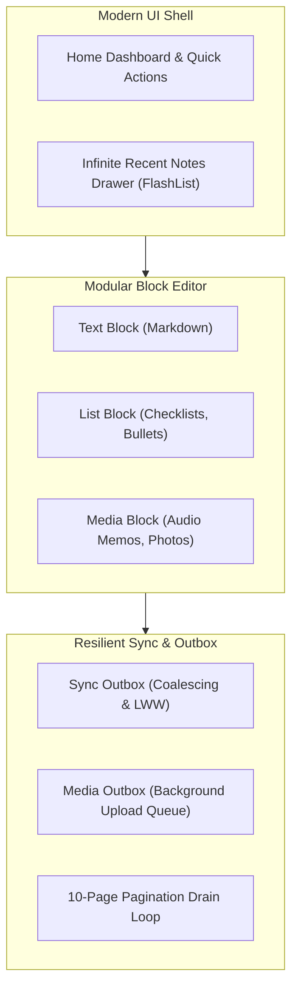

# iKeen Mobile v2.0.0 Release Notes

**Release Version:** `2.0.0`  
**Internal Build:** `6`  
**Release Date:** `2026-10-30`  
**Target Platforms:** Android (`com.techforgelee.ikeen`), iOS  
**Codename:** *The Modular Block & Media Era*  

---

## Executive Summary

iKeen 2.0.0 is the most significant upgrade to the mobile app to date. We have moved beyond monolithic text notes to a **modular block workspace** where users can freely mix rich text, interactive checklists, voice notes, and media attachments in any order. 

Paired with a **dedicated background media outbox**, an **overhauled navigation shell with an infinite recent notes drawer**, and an **enterprise-grade, crash-resilient sync engine**, iKeen 2.0 delivers the fluid, local-first performance required for serious thinking and note-taking.



---

## What's New in v2.0.0

### 1. Modular Note Blocks Architecture
* **Granular Block Hierarchy**: Notes are now stored as an ordered tree of distinct block entities rather than a single markdown string.
* **Interactive Checklists & Lists** ([`list-block.tsx`](../../../apps/mobile/src/components/notes/blocks/list-block.tsx)):
  * Tap checkboxes to toggle completion state with haptic feedback.
  * Reorder list items, indent/outdent bullets, and convert between ordered and unordered lists seamlessly.
* **Rich Text Blocks** ([`text-block.tsx`](../../../apps/mobile/src/components/notes/blocks/text-block.tsx)):
  * Low-latency text input with live Markdown rendering for headings, emphasis, blockquotes, and inline code.
* **Dual-Way Compatibility Bridge**: Automatic bi-directional serialization maintains backward compatibility with legacy `note.content` readers and external export tools.

### 2. Audio Voice Notes & Media Pipeline
* **Voice Memos** ([`media-block.tsx`](../../../apps/mobile/src/components/notes/blocks/media-block.tsx)):
  * Record voice notes directly from within any note using `expo-audio`.
  * Visual waveform preview and playback controls.
  * Audio recordings are cached locally for immediate offline playback and queued for cloud upload.
* **Photo Attachments & Galleries**:
  * Take photos directly into notes or select high-resolution images from the photo library.
  * Grid layouts, carousels, and full-screen lightbox previews.
* **Dedicated Media Outbox** ([`media-outbox.ts`](../../../apps/mobile/src/lib/sync/media-outbox.ts)):
  * Independent background upload engine managing large binary transfers without blocking lightweight note metadata sync.
  * Tracks media states (`queued` &rarr; `uploading` &rarr; `uploaded` / `failed`) with exponential backoff retries.

### 3. Reimagined Home Shell & Infinite Drawer
* **Revamped Home Screen**:
  * Action-oriented greeting banner with quick shortcuts for "New Note", "Record Voice Memo", and "Capture Photo".
  * Fast filter tabs (Pinned, Notes, Ideas, Audio).
* **Infinite Sliding Drawer** ([`b31da29`](https://github.com/techforgelee/ikeen/commit/b31da29)):
  * High-performance sliding drawer powered by `@shopify/flash-list`.
  * Virtualized recent notes feed allows instant switching between workspace documents without returning to the root home tab.
* **Adaptive NoteCard Previews**:
  * Structured cards dynamically generate excerpts from the first text block, count checklist completion (e.g., `3/5 items completed`), and surface thumbnail badges for attached media.

### 4. Hardened Sync Engine & Crash Protection
* **Multi-Page Pagination Draining**:
  * Added a 10-page drain loop to `SyncManager.pull()` to download all server batches without skipping records on fresh logins or extended offline reconnects.
* **Server Cursor Timestamp Clamping**:
  * The backend now clamps delta pull cursors to `Math.min(...truncatedTimes)` when query limits (250 items) are reached, preventing clock skew and missing updates.
* **Startup Crash Recovery Gate**:
  * Added `startupPromise` in `SyncManager` ensuring all abandoned `in_flight` mutations from an app crash or hard close are safely restored to `pending` before new sync cycles run.
* **Outbox Coalescing**:
  * Enqueuing an update for an entity with existing `pending` or `failed` records now merges the payloads, resets `status = 'pending'`, and resets `retryCount = 0`, eliminating sync thrashing.
* **Strict Error Handling**:
  * Backend throws `422 UnprocessableEntityException` if a block's parent note is missing, preventing false success acknowledgments and ensuring local edits remain safely in the outbox.

### 5. Block-Level AI & MCP Agent Tools
* **Agent Block Manipulation**:
  * The AI agent (`AgentService` & `IkeenMcpServer`) can now insert, modify, and delete individual blocks rather than rewriting entire notes.
* **Mediadock AI Image Generation**:
  * Ask the agent to generate concept art or illustrations and have them automatically inserted into a note's media block.

---

## Database & Schema Diffs

### SQLite (`apps/mobile/src/lib/db/schema.ts`)

#### 1. `note_blocks` (New Table)
```sql
CREATE TABLE note_blocks (
  id TEXT PRIMARY KEY NOT NULL,
  note_id TEXT NOT NULL REFERENCES notes(id) ON DELETE CASCADE,
  parent_id TEXT,
  type TEXT NOT NULL,          -- 'text' | 'list' | 'media'
  content TEXT NOT NULL,       -- Markdown string or serialized JSON array
  order_index REAL NOT NULL,
  created_at TEXT NOT NULL,
  updated_at TEXT NOT NULL
);
CREATE INDEX idx_note_blocks_note_id ON note_blocks(note_id);
CREATE INDEX idx_note_blocks_order ON note_blocks(note_id, order_index);
```

#### 2. `media_outbox` (New Table)
```sql
CREATE TABLE media_outbox (
  id TEXT PRIMARY KEY NOT NULL,
  note_id TEXT NOT NULL,
  block_id TEXT,
  local_uri TEXT NOT NULL,
  remote_url TEXT,
  mime_type TEXT NOT NULL,
  file_size INTEGER NOT NULL,
  status TEXT NOT NULL,        -- 'queued' | 'uploading' | 'uploaded' | 'failed'
  retry_count INTEGER DEFAULT 0 NOT NULL,
  last_error TEXT,
  created_at TEXT NOT NULL,
  updated_at TEXT NOT NULL
);
CREATE INDEX idx_media_outbox_status ON media_outbox(status);
```

---

## API & Sync Contracts

### Push Payload Extension (`POST /sync/push`)
```json
{
  "clientTimestamp": "2026-10-30T09:00:00.000Z",
  "folders": [...],
  "notes": [...],
  "note_blocks": [
    {
      "id": "block-uuid",
      "mutationId": "note_blocks:upsert:block-uuid",
      "action": "upsert",
      "version": 1,
      "updatedAt": "2026-10-30T09:00:00.000Z",
      "changes": {
        "noteId": "note-uuid",
        "type": "list",
        "content": "[{\"id\":\"item-1\",\"text\":\"Review PR\",\"checked\":true}]",
        "listType": "checkbox",
        "order": 1.0
      }
    }
  ]
}
```

### Pull Response Extension (`GET /sync/pull?since=...`)
```json
{
  "serverTimestamp": "2026-10-30T09:00:01.000Z",
  "folders": [...],
  "notes": [...],
  "note_blocks": [
    {
      "id": "block-uuid",
      "noteId": "note-uuid",
      "type": "list",
      "content": "[{\"id\":\"item-1\",\"text\":\"Review PR\",\"checked\":true}]",
      "listType": "checkbox",
      "order": 1.0,
      "version": 1,
      "updatedAt": "2026-10-30T09:00:00.000Z"
    }
  ]
}
```

---

## Breaking Changes & Migration Notes

1. **Guest Mode & Local Notes**: Existing local notes without blocks automatically generate a default `text` block upon first opening or editing in v2.0.0. No user data is lost.
2. **NoteCard Rendering**: Previews now read structured blocks first. If legacy `content` is present, it gracefully falls back to text excerpting.
3. **EAS Build Requirements**: Requires Bun `1.3.6` and Expo SDK `~57.0.21` during EAS cloud builds.

---

## Physical Device QA Checklist

- [ ] **Clean Install**: Install build on a clean device. Verify guest mode note creation works without network.
- [ ] **Checklist Blocks**: Create a list block, add 3 items, tap to check two items, verify state persists after app restart.
- [ ] **Voice Note Capture**: Grant microphone permissions, record a 10-second memo, play it back, verify audio plays smoothly.
- [ ] **Photo Attachment**: Take a picture with the camera, verify thumbnail renders in the note and on the Home card.
- [ ] **Infinite Drawer**: Swipe open drawer from left edge, scroll through recent notes, tap to navigate.
- [ ] **Offline & Sync**:
  1. Turn on Airplane mode.
  2. Create a note with a checklist and text block.
  3. Turn off Airplane mode.
  4. Verify note and blocks sync to cloud within 5 seconds.
- [ ] **Startup Recovery**: Force close the app while sync is in progress; reopen app and verify outbox status returns to `idle` with 0 stranded `in_flight` rows.
