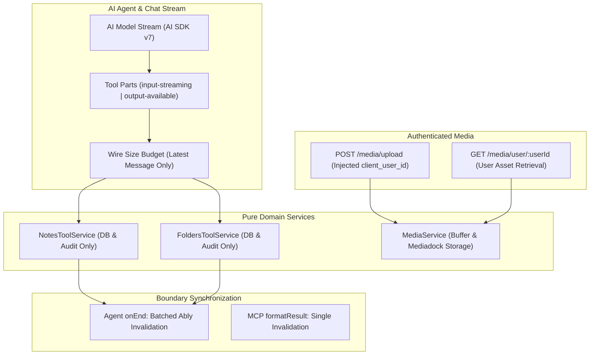

# iKeen Mobile v2.0.1 Release Notes

**Release Version:** `2.0.1`  
**Internal Build:** `7`  
**Release Date:** `2026-10-31`  
**Target Platforms:** Android (`com.techforgelee.ikeen`), iOS  
**Codename:** *Agent Resilience & Media Enhancements*  

---

## Executive Summary

iKeen 2.0.1 is a targeted stability and hardening patch following the major 2.0.0 release. This update focuses on **AI agent schema resilience**, **AI SDK v7 streaming lifecycle fidelity**, **decoupled transport-boundary sync invalidations**, and **secure authenticated media uploads and retrieval**.

By eliminating LLM schema validation traps (where explicit `null` arguments previously failed tool inputs), fixing chat streaming indicators so spinners display accurately during tool execution, and injecting verified user identity into cloud media storage, v2.0.1 delivers a robust, polished experience across both offline note-taking and agent-assisted workflows.

---

## What's New & Fixed in v2.0.1

### 1. AI Agent Tool Schema Robustness ($O(1)$ Schema Resilience)
* **Resolved Tool Schema Optionality Trap**:
  * LLMs frequently supply explicit `null` values for omitted parameters (e.g. `{ folderId: null }` or `{ limit: null }`). In v2.0.0, plain `z.string().optional()` caused Zod validation rejections, triggering AI SDK v7 `rawInput` deprecation warnings or aborting execution with `InvalidToolInputError`.
  * Introduced canonical `optionalNullable(schema)` and `defaultNullable(schema, defaultValue)` helpers in [`call-options.ts`](../../../apps/api/src/modules/agent/call-options.ts).
  * Standardized all tool definitions across [`notes.tool-definitions.ts`](../../../apps/api/src/modules/notes/notes.tool-definitions.ts) and [`folders.tool-definitions.ts`](../../../apps/api/src/modules/folders/folders.tool-definitions.ts) as the single source of truth for both Agent tools and the MCP Server.

### 2. AI SDK v7 Streaming & UI State Handling
* **Lifecycle State Awareness** ([`chat-tool-part.tsx`](../../../apps/mobile/src/components/chat/chat-tool-part.tsx)):
  * Migrated tool cards from legacy binary states (`call` / `result`) to full AI SDK v7 states: `'input-streaming'`, `'input-available'`, `'output-available'`, `'output-error'`.
  * Tool cards now accurately compute `isRunning` across all active states so spinners (`Loader2`) spin during tool execution and action buttons do not render prematurely with empty parameters.
* **Wire Size Budget & HTTP 413 Protection** ([`agent/index.tsx`](../../../apps/mobile/src/app/agent/index.tsx)):
  * Mobile client now sends **only the latest user message** (`[messages[messages.length - 1]]`) on turn submissions.
  * Protects backend context token budgets, eliminates network redundancy, and prevents HTTP 413 "Request Entity Too Large" errors over long-running chat sessions.

### 3. Decoupled Boundary Sync Invalidation
* **Domain Service Decoupling**:
  * Removed all leaky `if (source !== 'agent') void this.ably.publishInvalidation(...)` checks from low-level CRUD services ([`notes-tool.service.ts`](../../../apps/api/src/modules/notes/notes-tool.service.ts) and [`folders-tool.service.ts`](../../../apps/api/src/modules/folders/folders-tool.service.ts)).
  * Domain services now focus purely on database mutations and audit logging.
* **Canonical Boundary Publications** ([`sync-events.constants.ts`](../../../apps/api/src/modules/sync/sync-events.constants.ts)):
  * Agent turns consolidate all mutated entities (`notes`, `note_blocks`, `folders`) across multi-step execution into **1 batched Ably event** at turn completion (`onEnd`).
  * MCP server invokes consolidated invalidation upon tool resolution in `formatResult`.

### 4. Authenticated Media Upload & User Media Retrieval
* **Server-Side Identity Injection** ([`media.service.ts`](../../../apps/api/src/modules/media/media.service.ts)):
  * Multipart uploads to Mediadock storage now automatically attach `client_user_id` derived directly from the verified session (`req.user.id`). No client payloads or parameters are required.
  * Image generation via Agent tool (`generateImageKeen`) forwards the conversation's authenticated `userId` through to cloud storage.
* **User Media Retrieval Endpoint** ([`media.controller.ts`](../../../apps/api/src/modules/media/media.controller.ts)):
  * Added `GET /media/user/:userId` guarded by `JwtAuthGuard`.
  * Strictly enforces user ownership (`userId === req.user.id`), throwing `ForbiddenException` on unauthorized cross-user access attempts.
  * Returns paginated asset records from upstream Mediadock storage.

### 5. Mobile List Block Polish
* **Interaction & Keyboard Ergonomics** ([`list-block.tsx`](../../../apps/mobile/src/components/notes/blocks/list-block.tsx), [`list-item-row.tsx`](../../../apps/mobile/src/components/notes/blocks/list-item-row.tsx)):
  * Enhanced multi-line markdown paste splitting.
  * Refined enter and backspace item splitting with deterministic keyboard focus.
  * Polished drag handles and options sheets.

---

## Data Model & Schema Parity

* **No Schema Migrations Required**: Database schemas for SQLite (`apps/mobile/src/db/schema.ts`) and PostgreSQL (`apps/api/prisma/schema.prisma`) remain 100% backward compatible with v2.0.0.

---

## API & Sync Contracts

| Route / Transport | Method | Changes in v2.0.1 | Auth Required |
| :--- | :---: | :--- | :---: |
| `/media/upload` | `POST` | Injects authenticated `client_user_id` into storage metadata | Yes (`Bearer JWT`) |
| `/media/user/:userId` | `GET` | Fetches user's uploaded assets with pagination (`?page=1`) | Yes (`Bearer JWT`) |
| `/agent/chat` | `POST` | Accepts latest message payload; streams AI SDK v7 parts | Yes (`Bearer JWT`) |
| Ably `sync:invalidate` | Event | Batched at turn completion (`onEnd`) rather than per-tool | Token Auth |

---

## QA Verification Checklist

- [x] **Agent Note Creation**: Ask agent to create a note with explicit null folder (`{ folderId: null }`); verifies no Zod rejection occurs.
- [x] **Agent Tool Loading Spinners**: Verify spinner spins continuously during multi-step tool calls and resolves cleanly to output card.
- [x] **Media Upload**: Upload an image attachment; verify `client_user_id` is populated in storage metadata without client parameters.
- [x] **User Media Endpoint**: Call `GET /media/user/{userId}` with matching JWT token; verify 200 response with paginated items.
- [x] **Cross-User Protection**: Call `GET /media/user/other-user`; verify 403 Forbidden is returned.
- [x] **Batch Sync Invalidation**: Run multi-step agent turn; verify only 1 batched `sync:invalidate` event is emitted on turn completion.
