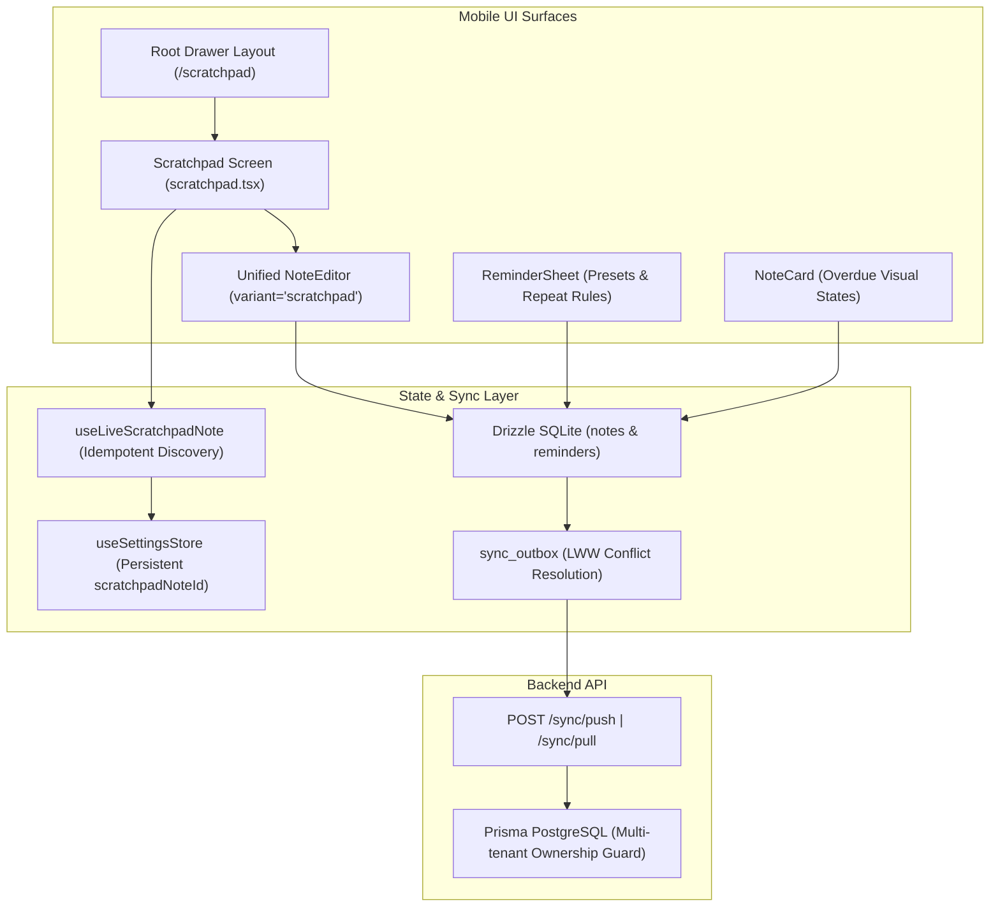

# iKeen Mobile v2.2.0 Release Notes

**Release Version:** `2.2.0`  
**Internal Build:** `9`  
**Release Date:** `2026-11-22`  
**Target Platforms:** Android (`com.techforgelee.ikeen`), iOS  
**Codename:** *Distraction-Free Scratchpad & Reminders Hardening*  

---

## Executive Summary

iKeen 2.2.0 introduces the **Cross-Platform Scratchpad**—a dedicated, distraction-free workspace for rapid note drafting, checklists, and outline brainstorming—alongside comprehensive hardening of the **Reminders Subsystem**, zero-data-loss unified editor lifecycle architecture, cold-start deep-linking, and enhanced multi-tenant backend isolation.

The Scratchpad leverages the canonical `scratchpad` tag and archived isolation, keeping fast drafts accessible across mobile and desktop without cluttering the primary notes feed. Reusing the official `NoteEditor` ensures synchronous dirty-state flushing during app backgrounding and navigation gestures.



---

## What's New & Hardened in v2.2.0

### 1. Cross-Platform Scratchpad Workspace
* **Dedicated Drawer Destination**: Added a permanent Scratchpad link (`/scratchpad`) with sticky note iconography in the root drawer navigation.
* **Idempotent Multi-Device Discovery** ([`apps/mobile/src/hooks/use-scratchpad.ts`](../../../apps/mobile/src/hooks/use-scratchpad.ts)):
  * Automatically resolves existing `scratchpad`-tagged notes from SQLite or sync without duplicating records across devices.
  * Provides zero-friction initial setup with quick actions to initialize a new scratchpad or link an existing note.
* **Unified Editor Architecture**:
  * Unified the mobile scratchpad onto the official, production-tested [`NoteEditor`](../../../apps/mobile/src/components/notes/note-editor.tsx) via `variant="scratchpad"`.
  * Guarantees zero data loss with `navigation.addListener('beforeRemove')` and `AppState.addEventListener('change')` interceptors flushing pending block edits before screen unmount.
  * Eliminated ~260 lines of duplicate editor code.

### 2. Reminders Subsystem Hardening & Reactive UX
* **Dynamic Overdue Visual States** ([`apps/mobile/src/components/notes/note-card.tsx`](../../../apps/mobile/src/components/notes/note-card.tsx)):
  * Overdue reminders automatically display prominent alert badges (`bg-red-500/10 border-red-500/25 text-red-500`).
  * Updating an overdue reminder to a future date immediately revalidates and restores the badge to primary theme styling.
* **Editor Canvas Reminder Pill** ([`apps/mobile/src/components/notes/note-editor.tsx`](../../../apps/mobile/src/components/notes/note-editor.tsx)):
  * Displays an interactive reminder status pill at the bottom of the editor canvas when an active reminder is set.
  * Tapping the pill opens the `ReminderSheet` for instant rescheduling or cancellation.
* **Cold-Start Notification Deep Linking** ([`apps/mobile/src/app/_layout.tsx`](../../../apps/mobile/src/app/_layout.tsx)):
  * Integrated `Notifications.getLastNotificationResponseAsync()` on mount to route directly to `/notes/[id]` when the user launches the app by tapping a delivered notification.
* **Recurrence Advancement Logic** ([`apps/mobile/src/lib/queries/reminders.ts`](../../../apps/mobile/src/lib/queries/reminders.ts)):
  * Added `computeNextDueAt` to roll recurring reminders forward (+1 day, +1 week, +1 month, +1 year) upon completion and reschedule native OS alerts.
  * Persists updated `notificationId`s directly into SQLite upon reminder updates.

### 3. Backend Multi-Tenant Security Isolation
* **LWW Ownership Verification** ([`apps/api/src/modules/notes/notes.service.ts`](../../../apps/api/src/modules/notes/notes.service.ts)):
  * Strict user ownership guard in `upsertReminderWithLww`:
    ```typescript
    if (existing && existing.userId !== userId) {
      return { applied: false, reminderId: r.id };
    }
    ```
  * Ensures multi-tenant isolation so reminder mutations from other accounts are rejected cleanly.

---

## Data Model & Schema Diffs

No destructive database schema migrations were introduced in this release. All features leverage existing schemas:
* **Scratchpad Tags**: Stored within the native SQLite / PostgreSQL JSON `tags` array (`tags: ["scratchpad"]`) with `isArchived: 1` / `isArchived: true` for clean feed isolation.
* **Reminders**: Maintained table parity across Drizzle (`reminders`) and Prisma (`Reminder`).

---

## QA Verification Checklist

- [x] **Scratchpad First Launch**: Open app drawer, navigate to `/scratchpad`. Verify the uninitialized state renders "Create Scratchpad Note" and "Choose Existing Note".
- [x] **Scratchpad Editing & Persistence**: Type note blocks, press hardware back button or swipe to close. Verify content is persisted upon reopening.
- [x] **Scratchpad Multi-Device Sync**: Create a scratchpad note on Mobile. Open Desktop client and verify it appears under Desktop Scratchpad view with matching contents.
- [x] **Overdue Styling**: Set a reminder in the past. Verify note card displays red overdue badge. Reschedule to tomorrow and verify card badge turns primary.
- [x] **Editor Reminder Pill**: Open a note with an active reminder. Verify reminder pill renders at the bottom of content. Tap pill to edit.
- [x] **Cold-Start Notification**: Schedule reminder, kill the app process, wait for alert trigger, and tap notification. Verify app opens directly to the targeted note.
